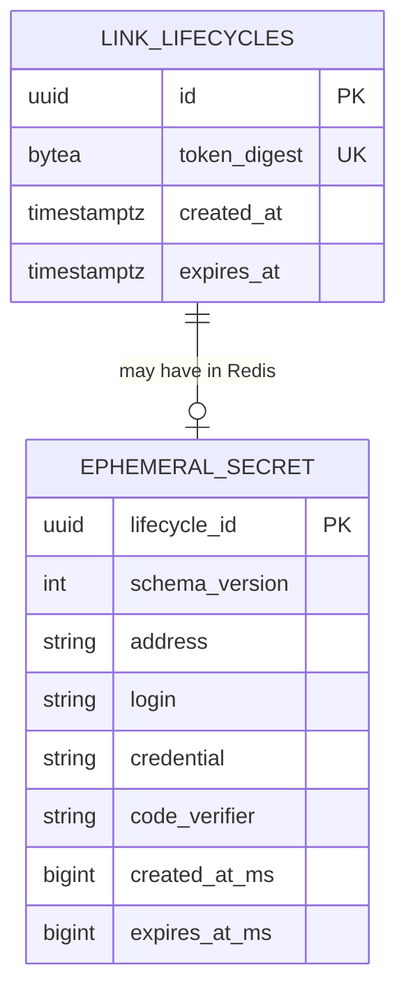

# Data model — short-live-path

## Scope and conventions

Size M, route standard. Sources: spec §5/§6.1, SAD §§4–8 and S1–S7, Accepted ADR-0001/0003/0004/0005, backend/docs/architecture.md and backend/AGENTS.md. There is no architecture-map.md, application domain layer, package manifest, live schema or migration history to corroborate. The authored backend architecture is the convention source; its approved feature exceptions live in the SAD. This is greenfield design, not a schema extracted from running software.

Product Owner selected a separate UUID primary key when offered the minimal digest-keyed table. The accompanying proposal uses snake_case, a 32-byte SHA-256 digest in bytea, explicit service timestamps, CHECK constraints and no updated_at or soft deletion. UUID is an internal lifecycle handle, not a second public credential. Use service-generated UUID v4; no database extension or generated-ID default is needed. Public access still requires the random token, never this UUID.

The only durable aggregate is LinkLifecycle. Its ephemeral Secret and optional verifier share its expiration but are not relational child rows. Admission records are temporary safety state, not Sender/Recipient entities. No accounts, ownership tables, recipients, read history, view counter, permanent code-required flag, deletion marker or durable maintenance queue.

## ER diagram

The relationship crosses stores and is logical, not a PostgreSQL FK. Zero payloads is normal after early loss or expiration; one lifecycle never has multiple current payloads.

## Entities

### `link_lifecycles`

Aggregate root: LinkLifecycle. Store: PostgreSQL through a Lucid model called only by services. Retention: indefinite, including failed/unconfirmed creations whose metadata committed. Rows are logically immutable once the creation protocol publishes final timestamps. Expiration deletes neither this row nor its digest.

| Column | Type | Constraints | Notes |
|---|---|---|---|
| `id` | uuid | PK, NOT NULL | Service-generated UUID v4; internal handle for the Redis payload. Not an authorization capability or public lookup endpoint. |
| `token_digest` | bytea | NOT NULL, UNIQUE, exactly 32 bytes | SHA-256 over the decoded 32 random token bytes, not over an arbitrary textual spelling. |
| `created_at` | timestamptz | NOT NULL, finite, no DEFAULT | Service-established successful-creation timestamp; publication algorithm remains a blocker below. |
| `expires_at` | timestamptz | NOT NULL, finite, no DEFAULT | Exactly created_at plus the selected integer minutes, 1–1440. UTC instants; millisecond-aligned service values allow exact Redis/DTO mapping. |

Constraints: named PK/UNIQUE constraints, digest octet length and a finite positive lifetime of 60–86400 seconds divisible by 60. PostgreSQL epoch arithmetic rejects fractional-minute duration, including fractional-second boundaries; no session-timezone or calendar-day interval dependency is used. No trigger, generated column, JSONB, nullable column, updated_at, deleted_at or DB clock default. SQL permits PostgreSQL timestamp precision; service validation must enforce millisecond alignment and reject malformed stored records.

Access patterns: S1/S2 insert a fresh row; S3/S4 resolve the row by digest. Treat a unique collision as a failed attempt, never overwrite another lifecycle. A confirmed metadata write precedes any payload write. Unknown commit outcomes return no link; do not retry automatically or remove possibly committed metadata. S7 checks dependency health but does not scan permanent rows for Secret cleanup.

### Token and digest representation

Generate 32 cryptographically random bytes and encode as canonical unpadded base64url (43 characters). The API validator must decode to exactly 32 bytes and re-encode to check canonical spelling, including final padding bits, before lookup. Persist only SHA-256(decoded bytes), passed to PostgreSQL as binary parameters. The token and full URL are credentials; exclude them from logs, traces, SQL bindings diagnostics and Redis keys. SHA-256 is suitable here because tokens have high random entropy; it is not the Reading code verifier and not the address pseudonym algorithm. No digest key rotation is required. Exact route shape belongs to api.

### `ephemeral_secret` (Redis only)

Aggregate ownership: LinkLifecycle's optional ephemeral payload. Proposed versioned key: `slp:<environment>:secret:<lifecycle_uuid>:payload`. Redis HASH fields below are storage vocabulary, not public API fields. No SQL migration creates this entity.

| Field | Redis representation | Constraints / meaning |
|---|---|---|
| `schema_version` | Integer string `1` | Reject unknown versions or incomplete hashes safely. |
| `lifecycle_id` | Canonical UUID string | Must equal the key handle and resolved PostgreSQL id. |
| `address` | UTF-8 string | Optional input represented as empty string when absent; do not trim supplied text. |
| `login` | UTF-8 string | Optional input represented as empty string when absent; do not trim supplied text. |
| `credential` | UTF-8 string | Required, not whitespace-only; retain all valid submitted characters and line breaks. |
| `code_verifier` | Encoded salted password-hard hash, or absent field | Absence means no code required. Never persist the plaintext code; malformed present verifier fails closed, not as code-disabled. Algorithm/cost/budget follow Accepted ADR-0006 initial values; calibration is T21. |
| `created_at_ms` | UTC epoch-millisecond integer string | Must match the final PostgreSQL timestamp. |
| `expires_at_ms` | UTC epoch-millisecond integer string | Must match PostgreSQL and absolute Redis expiry. Never refresh on read or verification. |

Sum of UTF-8 bytes of address, login and credential is at most 65536, excluding verifier and packaging. Validate again on stored-record read before constructing a response. Render/copy text verbatim; never HTML or server-side destination fetching. No requirement for browser content encryption exists. Neutral status inspects eligibility and verifier presence only; it must not serialize payload fields into its response.

Publish the complete hash, absolute expiry and expiration-index membership in one admitted atomic operation; never expose a partially constructed record. Redis scripts are atomic with respect to interleaving but do not roll back earlier writes after a runtime/OOM error. Therefore script validation, memory-refusal behavior, capacity accounting and reconciliation must be designed/tested together before implementation. Never treat an uncertain write as proven absent. The final release checks readiness, current payload consistency and strict `now < expires_at`, after asynchronous hash work. Reads neither consume the payload nor change deadlines.

### Temporary admission state (Redis only)

These key/data shapes define the design contract. Exact lease values, fencing and transitions remain review blockers, not implemented scripts. Use a dedicated nonclustered Redis instance as in the SAD; multi-key operations require review before Redis Cluster or API replicas are introduced.

| Logical entity / key suffix under `slp:<environment>:` | Fields / members | Ownership and retention |
|---|---|---|
| `creation:<address_label>:state` | Version, ordered successful-creation `(attempt_id, at_ms)` entries, pending `(attempt_id, lease_until_ms, generation)` reservations, last relevant activity | Address-scoped rolling 60-second successful quota; successes plus potentially successful in-flight reservations cannot exceed 25. No raw address. |
| `verification:<lifecycle_uuid>:<address_label>:state` | Version, ordered failure `(attempt_id, at_ms)` entries, pending verification reservations with owner generation/lease, last relevant activity | Link/address pair; at most five failures plus occupied slots per rolling 60 seconds. Success releases only its slot, never clears prior failures. |
| `capacity:reservations` | Reservation id to lifecycle id, lease deadline and owner generation | Global concurrent creation safety; count committed active payloads plus occupied/uncertain reservations against 1000, with an atomic transition to avoid double counting on commit. |
| `payload:expiry` | ZSET: lifecycle UUID member, absolute expires_at_ms score | S7 due-record index; bounded by active/uncertain payload admission. Payload TTL can remove a hash first; index cleanup must tolerate that. |
| `limiter:expiry` | ZSET: limiter-state key or reservation handle member, maintenance deadline score | Enumerates active temporary state/reservations for bounded cleanup and cardinality accounting; no raw token, IP, code or content. |

Address label means a versioned HMAC-SHA-256 of the canonical trusted-proxy-derived address using a server-held key, not an enumerable bare IP hash. Proxy trust, canonicalization, key custody and continuity policy follow Accepted ADR-0007; actual topology/configuration and T2 executable fencing remain pending. Never put example raw-IP keys from the generic Redis baseline into this feature.

Pair/address state may use one packed versioned value inside its HASH, updated only by bounded server-side operations; arrays are bounded by their quota and reserved slots, not request volume. Count each pair/address record and every individual reservation toward the approved 10000 limiter-record units, even if reservations are embedded rather than separate Redis keys. The registry counts each unit exactly once; global structural index keys themselves are fixed overhead, not extra client limiter identities. Refuse before allocating a new unit at cap. The capacity-reservation map and registry must represent the same reservation, not create an uncounted parallel admission path.

Use absolute expiration for per-address/pair state no later than five minutes after the last relevant request, additionally bounded by link expiry for pair state. A throttled request may affect the retention deadline but must not append a failure, reserve work or move existing failure timestamps. Prune timestamps at rolling-window boundaries before decisions; rejected verification does not extend the failure window. Capacity reservations must have bounded leases; expired leases alone cannot free a slot while old work can still commit. Fencing/reconciliation must prove that work cannot later publish before releasing uncertain eligibility.

Global expiry/registry structures have no arbitrary whole-key TTL: dropping them would bypass safety or lose cleanup handles. Delete empty structures and prune due members explicitly, including index orphans when hashes expire first. Fixed structural keys contain only bounded handles/scores and are never backed up. A five-second bounded cleanup loop queries due scores; it must not scan indefinite PostgreSQL history or use unbounded Redis KEYS. Wrong-code and creation quota counters are separate; shared office addresses legitimately share their respective limits.

Maintenance run identity, generation/readiness fencing, bounded retry state and global hash-work admission belong to the single API process unless later design requires ephemeral shared ownership. Do not add a permanent maintenance table or queue. A prior process/run must never reopen current recovery readiness. Distributed attempts require a bounded global verifier queue/concurrency budget in addition to pair limits.

## Indexes

| Index | Columns / structure | Query it serves |
|---|---|---|
| `link_lifecycles_pkey` | PostgreSQL B-tree `id` | Enforces unique internal lifecycle handles used for S1 payload association; Lucid primary-key identity. |
| `link_lifecycles_token_digest_unique` | PostgreSQL unique B-tree `token_digest` | S3/S4 exact digest lookup for known/expired/early-unavailable distinction; S1 collision protection. |
| `payload:expiry` | Redis ZSET `expires_at_ms` score, lifecycle handle member | S7 select due payload/verifier handles in bounded batches; S2 orphans use original expiry. |
| `limiter:expiry` | Redis ZSET maintenance deadline score, state/reservation handle member | S7 due limiter cleanup and reservation reconciliation; cardinality guard before S2/S4 admission. |
| Address / pair direct keys | Redis hash-key lookup | S2 per-address creation admission; S4 per-link/address verification admission. Rolling histories are bounded, so no separate failure-event index. |

No PostgreSQL expires_at/created_at index: no approved query filters permanent rows by time, and indefinite retention forbids automatic deletion. Cleanup selects Redis payload expiry, not durable metadata. No FK exists in SQL: the cross-store association cannot use a relational FK, and missing payloads are explicitly valid. Do not add duplicate indexes for PK/UNIQUE constraints.

## Lifecycle and failure semantics

| Observed state | Safe interpretation |
|---|---|
| Invalid token or successful digest lookup with no row | Unknown/unavailable, never fragments. |
| Valid row and authoritative time at or after expires_at | Explicit expired state at original URL; payload deletion does not remove recognition. |
| Valid unexpired row, successful Redis lookup with missing payload | Early unavailable; request a new link, no recovery. Recheck expiry before classification. |
| Valid unexpired row and valid payload | Neutral code-required/timing gate, or explicit eligible disclosure after authorization and final time check. |
| Dependency timeout, readiness/clock failure or invalid metadata | Temporary safe failure, not evidence of unknown/expired/wrong-code. |
| Metadata commit confirmed but Redis commit refused/uncertain | No confirmed link. Retain metadata; own orphan/reservation cleanup is bounded and cannot clear prior successes or extend expiration. |

No distributed transaction, automatic retry, idempotency recovery, per-person authorization or payload reconstruction from metadata is promised. A deliberate retry uses a fresh token/UUID and passes the same admission gates. Metadata-only backup restoration can restore expired recognition but never payload availability or code verification state. Redis restart begins empty; recovery gates remain closed until expired cleanup and safety-accounting continuity are resolved.

## Migrations and rollback

Staged only:

- `migrations/01_create_link_lifecycles.up.sql`
- `migrations/01_create_link_lifecycles.down.sql`

Paths above are relative to this feature folder. One pair creates/removes the only SQL aggregate. No seed migration, extension, Redis migration or live database change. IF NOT EXISTS supports replay of the intended DDL but does not validate an arbitrary preexisting incompatible table; promotion must inspect schema/migration history and fail on a mismatch.

Promotion target: backend/database/migrations/, using the Lucid timestamp-prefixed TypeScript BaseSchema up/down wrapper selected by the scaffolded application. `implement` assigns the real timestamp and wraps these SQL statements using the installed Lucid API. There is no next numeric sequence to claim today. Do not place raw SQL files into Lucid's live tree and assume its runner loads them. This stage does not invent imports from an uninstalled package.

Down drops the table and its constraints/indexes, without CASCADE. It is schema-reversible, not data-recoverable: after real writes it destroys indefinite link recognition. Stop dependent code and preserve a metadata-only backup before an explicitly authorized real rollback. Restoring metadata must never restore Redis payloads. No expand/backfill/contract phase is needed for a new table; later incompatible changes require one.

## Test fixtures

No test framework/factory convention exists yet. Do not invent application imports. `_audit/schema-check.sql` supplies rollback-only synthetic metadata fixtures inside a transaction, including all integer lifetime values, boundaries and intentionally invalid rows. These are test fixtures, not bootstrap/lookup seeds and not a live seed migration. They contain only synthetic UUIDs/digests/timestamps, no credentials, real names, emails, addresses or full links.

Implementation must later add AC-citing application factories for optional/required-code payloads, exact multiline/multibyte text and 65536-byte boundaries, concurrent quota/pair reservations, memory/counter exhaustion, uncertain commits, expired/early-lost/unknown state, late releases and recovery. SQL tests cannot prove Redis atomic accounting, byte-preserving clipboard behavior, clock safety, deletion latency, backup exclusions or no-sensitive-log controls.

## Open technical decisions

These are inherited SAD §11 obligations, not approval to proceed with guessed runtime parameters.

Product Owner accepted [ADR-0006](adr/0006-bound-argon2id-reading-code-work-and-input.md) and [ADR-0007](adr/0007-canonicalize-trusted-addresses-and-fence-quota-resets.md) as starting values on 2026-10-22. DM-OQ-01 parameter selection and DM-OQ-05 address/continuity policy are accepted, not benchmarked or runtime-verified. T1 remains open for spec/API synchronization; T2 still owns executable fencing/time integration (DM-OQ-02…04). Benchmark calibration is [T21](tasks/benchmark-reading-code.md), after T3, and gates T20 rather than scaffolding. Actual proxy/key configuration and security/fault verification remain implementation/deployment obligations.

| ID | Decision | Owner / due |
|---|---|---|
| DM-OQ-01 | Accepted initial values in ADR-0006: Argon2id v19, m=65536 KiB/t=3/p=4, salt 16 bytes/output 32 bytes, 2 concurrent calls/no queue, code <=1024 UTF-8 bytes/body <=524288 wire bytes. T1 still synchronizes spec/API; T21 calibrates after T3. | Backend/security responsibility; source sync before feature implementation, benchmark after scaffolding/before T20. |
| DM-OQ-02 | Successful-creation anchor and cross-store final timestamp publication. PostgreSQL precedes Redis, so simply stamping metadata before hash/store work cannot prove AC-04. Define exact publication/failure transitions without extending any published/orphan deadline. <!-- TBD --> | Backend responsibility with Product Owner review, before executable tasks. |
| DM-OQ-03 | Authoritative clock, monotonic deadlines, discontinuity detection, cleanup batch/retry budget, maintenance run identity and readiness fencing. <!-- TBD --> | Backend/frontend responsibility, before executable tasks. |
| DM-OQ-04 | Reservation leases, generation fencing, uncertain/OOM partial-script outcomes, exact successful-quota/failure accounting and recovery reconciliation. Prove bounded cleanup and no late commit after lease release. <!-- TBD --> | Backend responsibility, before executable tasks. |
| DM-OQ-05 | Accepted policy in ADR-0007: pinned immediate proxy, canonical full address, versioned HMAC-SHA-256/32-byte deployment key, stable restart identity and fenced >=60s quiet interval on continuity loss/rotation. Actual allowlist/key provisioning and T2 fencing/time integration remain pending. | Backend/security responsibility; T1 source sync, T2 executable protocol, deployment verification before launch. |

Token/digest/schema choices are resolved here; these runtime blockers are not. No independent security approval or implemented Redis protection is claimed.
