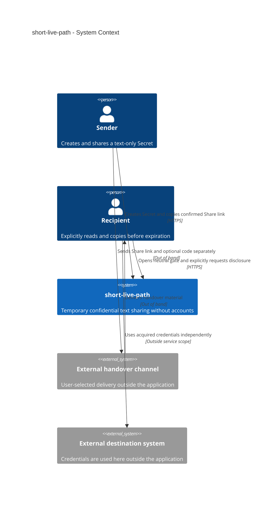
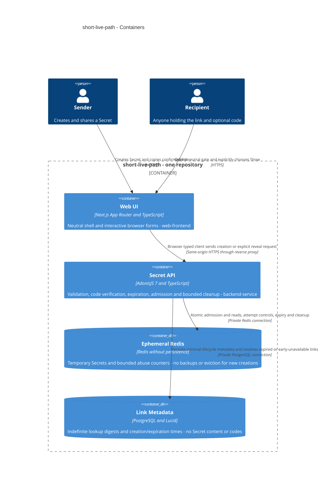
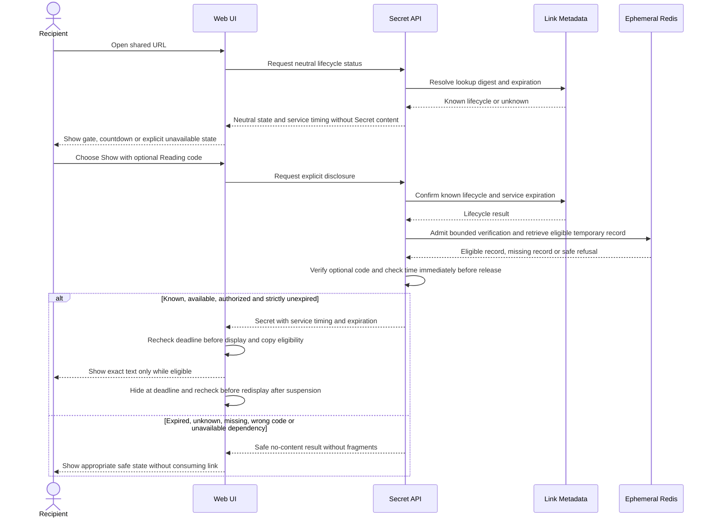
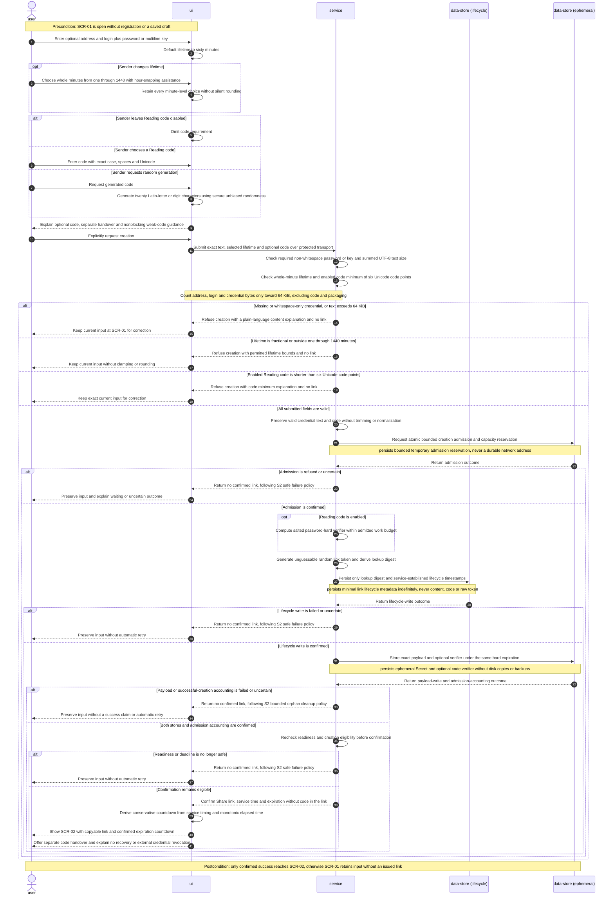
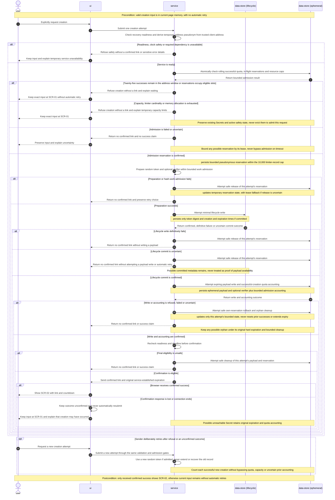
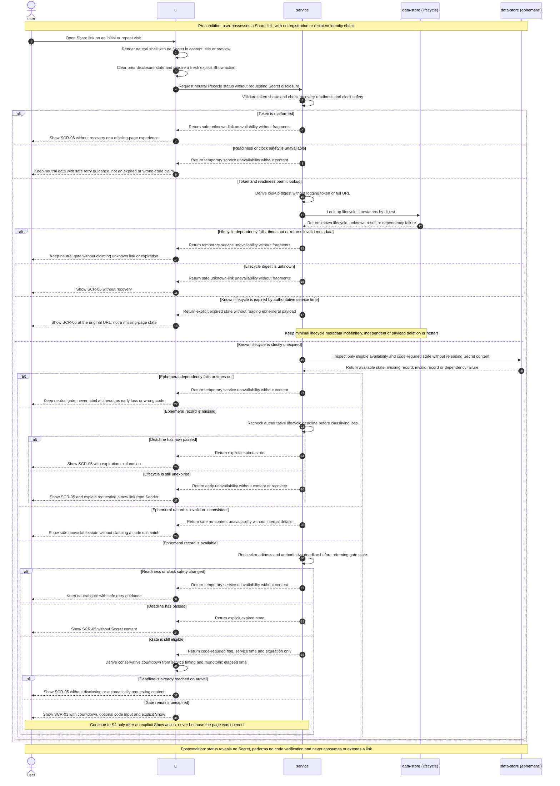
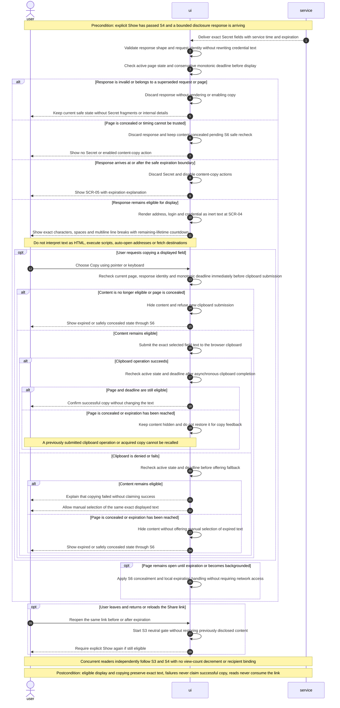
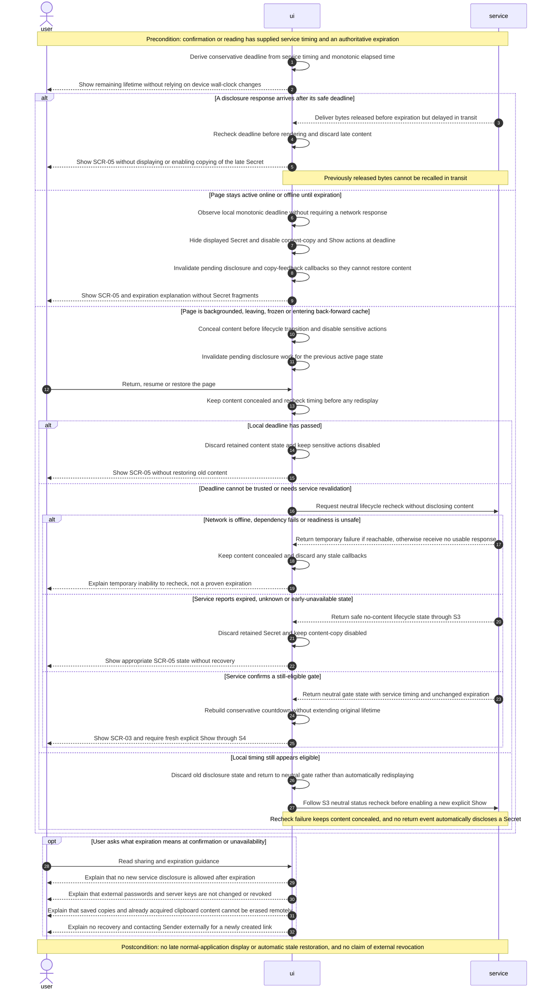
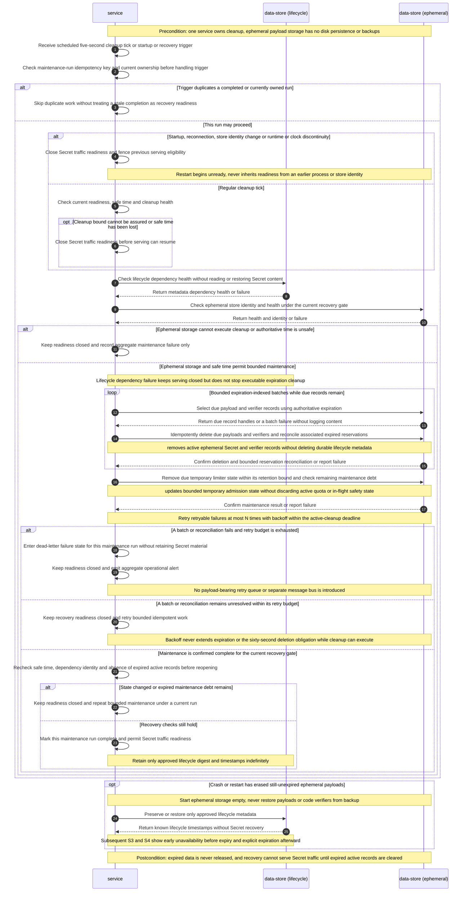

# Software Architecture Document — short-live-path


## 1. Introduction and goals


**Intent.** Enable a Sender to share a text-only Secret anonymously through a temporary Share link, and a Recipient to read it repeatedly before expiration, optionally using a separate Reading code. Preserve exact credential text without introducing accounts, history, recovery, file transfer, early removal or external credential revocation. Sources: spec §§1–6 and CONTEXT.md.

**Top-3 quality goals (ordered; full scenarios in §10):**

1. Confidentiality and bounded retention: HTTPS transport; server processing and live operator access are accepted, but no Secret content or Reading codes enter logs, analytics or backups, no full Share link is logged, and no persistent Secret copies are allowed (revised NFR-04).
2. Expiration and erasure: no new service release at or after expiration; no late display in the normal application; active Secret data removed within 60 seconds while Redis can execute cleanup; expired records cleared before Secret traffic resumes after suspension/hang, without a physical RAM-erasure deadline during that suspension/hang (revised NFR-03). Earlier loss on crash/restart is allowed; confidentiality takes priority over recovery.
3. Usability and performance: preserve exact text; p95 at most 2 seconds at 10 operations per second for Secret text up to 64 KiB; usable from 360 pixels wide with keyboard-operable primary actions (NFR-01, NFR-06). Availability of at least 99.5% per calendar month remains mandatory (NFR-02), not grounds to weaken the first two goals.

All other acceptance criteria and NFRs remain mandatory regardless of ranking.

**Stakeholders.**

| Role | Interest | Sign-off owner? |
|---|---|---|
| Sender | Anonymous creation, confirmed expiration and separate handover of link/code | No |
| Recipient | Explicit repeat reading and copying before expiration; safe unavailability | No |
| Product Owner | Product scope and accepted trade-offs; not an application role | Yes — product decisions |
| Tech Lead | Architecture, failure behavior and feasibility | Yes — architecture |
| Security Lead | Cryptography, key handling, retention and abuse review | Yes — security; review still required |


## 2. Constraints


**Technical.**
- Prescribed stack: TypeScript, AdonisJS 7, Next.js App Router, pnpm and Docker Compose. No application source, package manifests, lockfiles or Compose configuration existed at discovery; these are constraints, not installed or verified dependencies. Exact remaining versions must be pinned before implementation.
- Redis is selected for ephemeral Secret storage with disk persistence and backups disabled, under the revised server-readable model approved by Product Owner. This is an explicit exception to the PostgreSQL-source-of-truth/Redis-cache-only baseline, not proof of outage erasure. PostgreSQL stores minimal link lifecycle metadata indefinitely for now: lookup digest and creation/expiration times only, never Secret content, code hashes, plaintext codes, raw link tokens or full Share links. Exact Redis/deployment controls and resource budgets still require resolution and verification.
- Both applications remain in this repository under backend/ and frontend/, explicitly approved for this project. Generic baseline statements that they live in separate repositories do not apply; paths in each baseline are relative to its application directory.
- Secret content and optional Reading codes may be submitted to the backend over HTTPS. Browser encryption and fragment-carried content keys are not required. Neutral shells do not embed content; typed browser API calls perform creation and explicit disclosure without sensitive SSR caching. Storage must independently address expiration, retained copies and outage erasure.

**Organisational.**
- Implementation is planned collaboratively by the Product Owner and coding agent, without an additional staffed team being identified. Tech Lead and Security Lead denote review responsibilities; no independent human reviewer has been confirmed.
- Product Owner preference: implement during the current overnight working session. This is an aspirational delivery target, not a hard deadline or permission to weaken security requirements. No fixed effort budget or exact cutoff time has been supplied.
- Security/retention design blockers must be resolved before implementation readiness can be claimed; the overnight target does not waive review or verification.

**Conventions.**
- Backend: [AGENTS.md](../../../backend/AGENTS.md) and [architecture.md](../../../backend/docs/architecture.md); Controller → Service → Lucid Model for database-backed paths, thin controllers, service-owned business rules, no repositories by default. Any approved alternative Secret store requires an explicit documented exception rather than fictitious Lucid persistence.
- Frontend: [AGENTS.md](../../../frontend/AGENTS.md) and [architecture.md](../../../frontend/docs/architecture.md); thin App Router routes, typed API access in data/, framework-free entities/, UI in view/ and reusable primitives in shared/. Server Components are the default for nonsensitive shells, not for Secret processing.
- Preserve the versioned OpenAPI integration boundary and success envelope { data, meta }; errors use { error: { code, message, details } }. Feature endpoints are defined by the api stage, not invented here.
- Existing layering presets are baseline artifacts, not verified active lint gates. Tests must cite the AC they cover.

**Regulatory / external.**
- Confidential credential data; no jurisdiction-specific certification or legal compliance regime has been supplied or claimed.
- Spec §6.1 and NFR-03/NFR-04 govern confidentiality, expiration and retention. Secret payloads and Reading code verifiers are excluded from backups and disk persistence. Minimal PostgreSQL link lifecycle metadata is intentionally durable and distinct from Secret records; indefinite retention is explicitly approved, while backup scope for metadata is resolved in deployment design. The approved sixty-second active-record deletion bound applies while Redis can execute cleanup, not to physical RAM erasure during suspension/hang. Recovery clears expired records before Secret traffic resumes. TTL alone is not a bounded active-cleanup proof; explicit cleanup, recovery gating, snapshots, replicas, swap, crash dumps and retained copies require implementation and verification.
- Expiration does not revoke external credentials or erase Recipient-controlled copies. Security review remains required.

## 3. Context and scope


A Sender creates a temporary Share link for a confidential text-only Secret; a Recipient opens a neutral page and explicitly requests disclosure, with a separate Reading code when enabled. The service does not provision, connect to, validate or revoke the external access described in the Secret. Delivery of the link/code occurs outside this application without an integrated messaging provider.

<!-- brownfield: N/A — greenfield repo; independent exploration found baseline documents and lint presets, but no application source, manifests, lockfile, Compose configuration or architecture map. -->

**External systems (in / out):**

| Actor or system | Type | Interaction |
|---|---|---|
| Sender | Person | Creates a Secret and copies its confirmed Share link; sends optional Reading code separately |
| Recipient | Person | Opens a neutral gate; explicitly shows and copies available Secret text; may return before expiration |
| External handover channel | External system, contextual only | Sender-selected channel carries link and separately communicated code; no application integration or provider selection |
| External destination system | External system, contextual only | Recipient uses acquired credentials outside the service; the service never contacts it or revokes its credentials |

**Trust boundaries.** The service may receive and read Secret content and optional Reading codes over HTTPS; live operator access is accepted. There is no browser-only decryption-key boundary. A complete Share link is a credential, not proof of identity. No identity provider, account or ownership-management API is introduced. One URL may be shared with multiple readers. Durable minimal lifecycle metadata permits explicit expired states independently of Redis availability; a visible countdown derives from service-established time. Out-of-band channels and external destinations are outside the confidentiality/retention guarantee; recipient copies cannot be revoked. Redis and any other selected internal datastore belong to the container view, not external business integrations.

**C4 Context (L1), confirmed by Product Owner:**



## 4. Solution strategy


**Approved strategic decisions (implementation details continue in §§5–8).**

1. **Build web-frontend and backend-service** — One responsive browser interface supports Sender and Recipient on mobile and desktop; AdonisJS provides service-controlled expiration and abuse enforcement. Both applications live in this repository. See ADR-0001.
2. **Use a neutral Next.js shell and a server-readable ephemeral service** — Neutral shells and interactive browser forms remain; typed API clients submit content and optional Reading codes over HTTPS to AdonisJS. No client-side content encryption or key fragment is required. Sensitive browser state stays in page memory without localStorage, IndexedDB, automatic drafts or sensitive service-worker caches. Repeat visits begin at the neutral gate. ADR-0003 supersedes ADR-0002’s operator-blind requirement.
3. **Store Secrets only in ephemeral Redis** — No disk persistence, Secret backups or PostgreSQL Secret rows. Check expiration immediately before release independently of Redis cleanup. Optional Reading code verification occurs server-side; an incorrect code does not consume a link. The code is stored as a verification hash, not plaintext. Permit at most five failed code verifications in any rolling sixty-second window for each Share link and client network address pair; deny further verifications for that pair while five failures remain in the window, without extending the window on rejected requests. Other addresses remain eligible, and no permanent or link-wide lockout is introduced. Shared-NAT readers share the pair limit. This is basic online protection, not protection against distributed guessing. The exact bounded verifier implementation and pre-verification concurrency controls remain pending.

**Creation limit (Product Owner amendment):** Permit at most 25 successful creations in any rolling sixty-second window per client network address, superseding the earlier proposed limits of ten and one hundred by explicit Product Owner amendment. Office users may share one public address. This does not change the approved five-failed-code-verifications limit for a Share link/address pair. The remainder of the package was subsequently explicitly confirmed: at most 1000 active Secrets, Redis maxmemory 256 MiB, reject new creations at capacity without evicting existing Secrets and retain current form text. Do not automatically retry creation or claim unconfirmed success; a manual retry is a new creation, and any unreachable earlier record keeps its original expiration. Counter keys use temporary pseudonymous network-address labels, no IP logging, at most five minutes retention after the last request, and bounded cardinality. These are initial configuration values, not measured capacity. Counter cap, pseudonym details and concurrency-safe admission remain concrete design details.

4. **Persist minimal link lifecycle metadata indefinitely for now** — PostgreSQL stores only a lookup digest of the unguessable link token and creation/expiration timestamps. Content and code verifiers stay exclusively in ephemeral Redis. Known expired URLs remain usable for an explicit expired message, not a 404; known unexpired records with missing Redis payload show early unavailability. Confirmation and reading experiences display a service-time-based remaining-lifetime countdown. Indefinite metadata retention is approved for now and may be revised later, without implying indefinite Secret retention. See ADR-0005.

**Pending decisions:** bounded Reading code hash/verifier implementation, pre-verification attempt/concurrency reservation, concrete Redis/infrastructure cleanup and recovery controls, counter cardinality/privacy details, concurrency-safe capacity enforcement and cross-store creation/failure ordering. Resource budgets and manual-retry semantics are approved. Server-readable processing and the optional code were explicitly confirmed by Product Owner. No implementation-readiness or security-review approval is implied.

**Decision override:** Product Owner withdrew the earlier operator-blind encryption requirement and approved server-readable processing, while retaining the optional Reading code, no-sensitive-log/backup rules and expiration/erasure guarantees. Earlier sections and upstream spec are synchronized rather than leaving contradictory approved requirements.

**Decision override (retention):** Product Owner accepted a scoped active-record deletion guarantee: within sixty seconds while Redis can execute cleanup; no physical RAM-erasure deadline during process/VM suspension or hang; expired records cleared before Secret traffic resumes after recovery. No disk persistence, Secret backups or recovery is introduced. Deletion does not claim forensic RAM zeroization.

## 5. Building block view


Use the prescribed layered applications, not microservices. Thin AdonisJS controllers validate and delegate to services; services own lifecycle rules, Redis access and Lucid metadata operations. PostgreSQL is authoritative for durable link lifecycle metadata; Redis is authoritative only for ephemeral payload availability and bounded admission/abuse counters, an explicit exception to the baseline cache-only rule. The browser uses typed data-layer clients and renders Secret text as inert text, never HTML or a redirect. No recipient identity/list or ownership-management module is introduced.

**Internal decomposition (planned paths, not existing code):**

```
backend/
  app/controllers/       creation, neutral status and explicit disclosure boundaries
  app/validators/        exact text, UTF-8 size, lifetime and code validation
  app/services/          lifecycle orchestration, Redis admission/cleanup and code verification
  app/models/            Lucid link lifecycle metadata only
  app/middleware/        safe errors, trusted client address and admission controls
  database/migrations/   minimal durable metadata schema, paired rollback implications
  start/                 routes and runtime wiring
frontend/
  src/app/               thin neutral routes, layouts and metadata
  src/data/              typed API access and DTO mapping
  src/entities/          framework-free lifecycle and Secret types
  src/view/              create form, share confirmation, reading gate/content/unavailable states
  src/shared/            generic controls, safe text/copy utilities and countdown timing helpers
```

**Ownership and invariants.** Web UI presents SCR-01 through SCR-05, exact copying and service-time-derived countdowns. Secret API owns the versioned contract, safe status distinctions, reading authorization, deadlines, cleanup and recovery gates. Link Metadata keeps only token lookup digests and creation/expiration timestamps indefinitely for now; it must not imply payload availability. Ephemeral Redis alone holds payloads and code verifiers and may lose them on restart. A known expired link always resolves to an expired page; unknown links are safely unavailable, and known unexpired links missing payloads are early-unavailable. Concrete cross-store ordering and failure branches are resolved in §6, not hidden behind a nonexistent distributed transaction. All browser/server responses containing content are noncacheable; detailed controls are in §§7–8.

**C4 Container (L2), revised to the confirmed PostgreSQL metadata decision:**



Confirmed boundaries after Product Owner amendment: one responsive Web UI, one Secret API, one dedicated ephemeral Redis instance and PostgreSQL for minimal lifecycle metadata. No PostgreSQL Secret content or code-verifier store, external messaging integration, queue or separate worker deployable. The API owns cleanup scheduling and recovery readiness, so it is not a fourth surface. The reverse proxy routes the public API prefix directly to AdonisJS; Next.js renders only neutral shells and does not act as a sensitive-data relay. Concrete runtime controls and route contracts remain §§7–8 and the api stage.

## 6. Runtime view


The primary runtime flows below reflect the approved server-readable model. Participants are the §5 containers; messages are semantic rather than endpoint contracts.

**Critical flow 1: create and confirm.**


**Creation ordering and partial failure.** This diagram shows the success-path order, not a distributed transaction. A definitive PostgreSQL failure stops before payload creation; Redis reservations expire and are bounded. A committed metadata row without a Redis payload is harmless early unavailability, not a success claim. An uncertain PostgreSQL commit is treated as unconfirmed and does not trigger an automatic payload write or retry. A Redis timeout after an attempted write may leave an unreachable payload and/or reservation: best-effort rollback is not proof of absence, so every possible payload keeps a hard expiration and bounded cleanup. A manual retry uses a new random token, consumes a new successful-creation slot if it succeeds, and never extends an old record. Concrete atomic reservation, commit-time timestamp publication and quota accounting must be proven in implementation tests; no cross-store atomicity or deduplication is promised.

**Critical flow 2: neutral status, explicit disclosure and expiry.**



**Approved state/failure policy.** Known expired links use PostgreSQL metadata to show expired even if Redis data is gone. Known unexpired metadata with a missing Redis record means early unavailability. Unknown links are safely unavailable. A dependency timeout is temporary service unavailability, never evidence of expiration, an unknown link or an incorrect code. If either required store is unavailable, disclosure fails closed; there is no alternate read path that bypasses checks. The diagram abbreviates failure exits: after a metadata rejection or dependency failure, stop before optional verification or further store calls. Neutral status never releases content. No visit or successful read consumes a link, including concurrent reads.

**Time and disclosure.** Use authoritative service expiration, never the browser wall clock, for eligibility. Check immediately before the bounded nonstreaming release; previously released/in-flight bytes cannot be recalled. The browser derives a conservative deadline from service timing and a monotonic clock, checks again after asynchronous work and before display/copy, hides on deadline, and conceals content before background/suspension return until a safe recheck completes. Late arrivals are discarded. The exact clock-jump, recovery and readiness controls are resolved in §§7–8. The sequences stage must extend these seeds to cover every AC, including concurrent code attempts, cleanup, partial failures, late responses and restoration without payload resurrection.

### S1. Create with lifetime and optional Reading code

Coverage: US-01, US-02, US-03; AC-01, AC-02, AC-04, AC-05, AC-06. Screen path: SCR-01 to SCR-02 only after confirmed success. Status: confirmed in prose by Product Owner.

The two design seed diagrams above are preserved verbatim. Additional runtime diagrams use generic participants mapped to §5: user (Sender or Recipient), ui (Web UI), service (Secret API), data-store (lifecycle metadata) and data-store (ephemeral payloads and admission state). The two store roles are not a distributed transaction or new building blocks. No external delivery integration is introduced.



**Timing and scope obligations.** Expiration is the selected duration after successful creation, not form entry or initial reservation. The messages above state the approved cross-store order, not a concrete timestamp-publication algorithm: §11 still requires the exact creation-time anchor, final timestamp publication and atomic successful-quota accounting to be resolved and tested before implementation. S2 expands all partial/uncertain creation paths, including a lost confirmation response. No plaintext code is retained in either store. The browser keeps form/code state only in current page memory. No complexity rule rejects an otherwise valid code. Exact lifetime-slider interaction remains owned by screens, and the finite code/request/hash resource budget remains an explicit §11 decision rather than an invented maximum.

### S2. Creation admission, partial failure and manual retry

Coverage: US-01 and US-02; AC-01/AC-04 confirmation integrity, AC-11 orphan retention and NFR-05. Screen path: refusal or uncertainty stays at SCR-01. Status: confirmed in prose by Product Owner.



**Admission and failure semantics.** At most 25 successful creations per rolling sixty-second address window and 1000 active Secrets are allowed, with Redis maxmemory 256 MiB/noeviction and at most 10,000 limiter records including reservations. People sharing a public address share its quota. Address/pair state uses temporary keyed pseudonyms, no raw IP logs or durable address records, and is removed no later than five minutes after the last relevant request. Rejected operations do not bypass protection or evict existing state. Parallel requests reserve eligibility before doing expensive work or writing a payload. Exact reservation leases, quota/accounting transitions, uncertainty reconciliation and successful-creation timestamp publication remain §11 obligations: an unknown result must not be counted as a proven failure and used to free a slot that could permit quota overshoot. Safe cleanup may be attempted but is not proof of absence after a timeout. Durable lifecycle metadata is retained under the approved policy, not deleted as payload rollback. S7 supplies recovery gating and bounded expiration cleanup. A manual retry is a new creation, not deduplication, recovery or an extension of any earlier lifetime.

### S3. Open a neutral gate and resolve safe lifecycle states

Coverage: US-04 and US-05; AC-04 countdown, AC-08, AC-09 and AC-11b. Screen path: initial and repeat visits enter SCR-03 without content, or SCR-05 for terminal unavailability. Status: confirmed in prose by Product Owner.



**Status boundaries.** Neutral status does not decrement a view count, verify a Reading code, change expiration or persist a recipient identity. Read-only availability inspection is not permission to serialize payload fields into a status response, neutral HTML, preview, logs or cache. All status responses and sensitive routes remain noncacheable under §8. A status success is not a reservation or guarantee of later readability: S4 independently rechecks lifecycle, payload, authorization and time. Known expired metadata can produce an explicit expired state without Redis payload access while the service is otherwise ready. It does not bypass S7's closed recovery gate or turn a required dependency failure into an alternative disclosure path. A still-unexpired lost payload may follow crash/restart and cannot be restored from metadata. No read or status visit recovers an old Secret, and concurrent visitors do not compete for a view allowance. SCR-05 explains limits through S6. No new participant or persistence operation is introduced by this read-only flow.

### S4. Explicit disclosure and concurrency-safe Reading code verification

Coverage: US-03, US-04 and US-05; AC-06 exact comparison, AC-07, AC-08 and AC-10 pre-release check. Screen path: explicit Show from SCR-03, with eligible content handed to S5 only on success. Status: confirmed in prose by Product Owner.

```mermaid
sequenceDiagram
    autonumber
    actor U as user
    participant UI as ui
    participant S as service
    participant M as data-store (lifecycle)
    participant E as data-store (ephemeral)
    Note over U,E: Precondition: neutral gate has disclosed no Secret and a link is not consumed by reads
    U->>UI: Enter Reading code if required and explicitly choose Show
    UI->>S: Request disclosure with token and exact optional code over protected transport
    S->>S: Check token shape, request bounds, readiness, clock safety and trusted client address
    alt Request is invalid or readiness is unsafe
        S-->>UI: Return safe no-content refusal with appropriate unavailable or temporary-failure state
    else Request is eligible for lifecycle lookup
        S->>M: Resolve known lifecycle by token digest
        M-->>S: Return lifecycle or failure
        alt Lifecycle lookup fails or metadata is invalid
            S-->>UI: Return temporary service failure without Secret or code-mismatch claims
        else Link is unknown or already expired
            S-->>UI: Return safe unknown or explicit expired state without code verification
        else Known lifecycle is strictly unexpired
            S->>E: Read eligible payload and optional code-verifier state without consuming it
            E-->>S: Return eligible record, missing record, corrupt record or failure
            alt Ephemeral dependency fails or times out
                S-->>UI: Return temporary service failure without content or a code-mismatch claim
            else Payload is missing, expired or corrupt
                S->>S: Classify safe unavailable or expired state using lifecycle and current service time
                S-->>UI: Return no-content state without recovery or code verification
            else Eligible record is valid
                alt Record does not require a Reading code
                    S->>S: Mark this request authorized without creating a code-failure counter
                else Required code is absent
                    S-->>UI: Ask for required code without revealing content or consuming the link
                else Required code is supplied
                    S->>E: Atomically prune elapsed failures and reserve an eligible link-address verification slot
                    Note over S,E: persists bounded pair reservation using temporary keyed address pseudonym, never plaintext code
                    E-->>S: Return confirmed reservation, pair limit, resource refusal or uncertainty
                    alt Five failures remain within rolling sixty seconds or in-flight slots occupy the remainder
                        S-->>UI: Refuse verification temporarily without starting expensive hash work
                        Note over S,E: Do not add a failure timestamp or extend the window for this refusal
                    else Limiter capacity, reservation certainty or bounded hash-work admission is unavailable
                        S->>E: Attempt safe release of any own reservation without clearing prior failures
                        S-->>UI: Return safe temporary refusal without content or expensive verification
                    else Pair reservation and bounded hash-work admission are confirmed
                        S->>S: Verify exact code against salted password-hard hash without trimming or normalization
                        alt Verification fails internally or verifier state is corrupt
                            S->>E: Safely reconcile own reservation without fabricating a wrong-code result
                            S-->>UI: Return safe no-content failure without internal details
                        else Code is incorrect
                            S->>E: Atomically replace own reservation with a failed-verification timestamp
                            Note over S,E: persists rolling pair failure state, bounded in cardinality and retention
                            E-->>S: Return accounting outcome
                            S-->>UI: Return safe wrong-code result only if accounting is confirmed, otherwise temporary failure
                            Note over U,E: Never invalidate the link or block other addresses because this pair failed
                        else Code is correct
                            S->>E: Atomically release own in-flight slot without clearing other failed attempts
                            E-->>S: Return reservation-completion outcome
                            alt Reservation completion is failed or uncertain
                                S-->>UI: Return temporary no-content failure
                            else Reservation completion is confirmed
                                S->>S: Mark only this request authorized
                            end
                        end
                    end
                end
                opt This request is authorized and no previous branch returned a refusal
                    S->>E: Recheck eligible payload availability after asynchronous verification work
                    E-->>S: Return current eligible payload state or safe failure
                    alt Record is unavailable or dependency check fails
                        S-->>UI: Return safe no-content state, distinguishing temporary failure from known loss
                    else Record remains valid and available
                        S->>S: Construct bounded nonstreaming response and check readiness and time immediately before release
                        alt Readiness, clock safety or strict unexpired deadline check fails
                            S-->>UI: Refuse release without Secret content, even with a correct code
                        else Final release remains authorized and strictly unexpired
                            S-->>UI: Release exact Secret with service timing and expiration as noncacheable data
                            UI->>UI: Apply S5 and S6 checks before any display or copy
                        end
                    end
                end
            end
        end
    end
    Note over U,E: Postcondition: refusals reveal no fragments, only eligible requests release content, reads never consume or extend a link
```



**Concurrent-attempt semantics.** Each link/address pair admits no more in-flight verifications than its remaining failure allowance, so simultaneous wrong codes cannot overshoot five failed verifications in any rolling sixty-second window. Occupied in-flight slots may temporarily refuse even a correct attempt without running its hash. As old failure timestamps leave the window, slots become eligible again without a permanent or link-wide lockout. A refusal does not reset or extend those timestamps, and a successful verification does not erase other failures. Other addresses use independent pairs, while people behind the same public address share a pair. Global bounded hash work and its queue remain necessary against distributed attempts, not merely the per-pair check. Only salted verification hashes are stored, never plaintext submitted codes. Limiter state and reservations remain under §8's global cardinality and five-minute retention bounds. Exact lease expiry, crashed/uncertain in-flight reconciliation, code/request bounds, hash library/cost and key rotation/restart continuity remain §11 decisions: abandoned reservations must not allow still-running work to bypass the failure limit. Dependency or accounting uncertainty fails closed and is not mislabeled as an incorrect code. Every failure branch terminates that disclosure attempt before subsequent authorization/release steps. Code success grants no recipient identity, durable authorization or automatic Show on later visits. No new participant is introduced.

### S5. Display and copy exact text, with repeat and concurrent reading

Coverage: US-04; AC-03 and AC-08, with AC-04 countdown and AC-10 browser eligibility checks. Screen path: SCR-03 to SCR-04 only for eligible disclosure, with SCR-05 on expiration. Status: confirmed in prose by Product Owner.



**Browser and copy boundaries.** Copy helpers pass the original field string without trimming, newline conversion, Unicode normalization or formatting. Manual selection is a fallback while the same text remains eligible, not a download, stored draft or recovery feature. The browser clipboard is an existing browser capability owned by ui here, not a new external integration or §5 building block. Clipboard submission is guarded before it starts and asynchronous feedback is guarded again afterward: a submitted write that completes after expiration cannot be canceled reliably, and already acquired copies remain outside revocation guarantees. No late callback may redisplay expired content. Secret/code state is limited to current page memory, never localStorage, IndexedDB, service-worker caches, server-rendered payloads or analytics. S6 defines offline expiry, background concealment and return handling. Service checks still apply on every fresh Show even if this browser previously displayed the same Secret. Shared-address code throttling in S4 can temporarily refuse concurrent verifications, but successful reading never consumes a link or imposes an exclusive reader. No persistence operation or new participant is introduced.

### S6. Expiration, late responses and safe return to the page

Coverage: US-02, US-04 and US-05; AC-04 service-derived countdown, AC-10 and AC-12. Screen path: eligible SCR-02/SCR-03/SCR-04 timing, with SCR-05 at expiration and a neutral SCR-03 gate after a safe eligible return. Status: confirmed in prose by Product Owner.



**Time and lifecycle obligations.** The countdown is presentation, never permission to bypass S4's final service-side release check. Device wall-clock changes cannot extend the lifetime. Every asynchronous display/copy completion and page-lifecycle return must be fenced against stale requests and checked before it can affect visible Secret state. On return this flow deliberately uses the existing neutral gate and fresh Show instead of silently restoring old plaintext, consistent with the confirmed UX return path. No new account, screen, background network dependency for active offline hiding or external credential integration is introduced. If safe time cannot be established after suspension, content stays concealed until neutral revalidation and a fresh explicit Show succeed. Exact clock-source, sleep/discontinuity detection and conservative-deadline calculations remain §11 pre-implementation obligations, with browser/network profiles fixed before plan-tests. Browser lifecycle behavior, including back-forward cache, must be tested rather than inferred from headers. No guarantee is made against a modified client, recipient-controlled copies or physical RAM forensics. Stored payload cleanup is a separate S7 obligation, not something SCR-05 proves.

### S7. Bounded cleanup and recovery before serving

Coverage: US-05 and US-04 early loss; AC-11, AC-11b and the cleanup/recovery part of AC-10; NFR-03/NFR-04. This is an internal service flow, not a new user screen or separately deployed worker. Status: confirmed in prose by Product Owner.



**Asynchronous maintenance and failure handling.** The service's own scheduled loop is the trigger and handler, not an external scheduler, message bus or worker surface. Check a run identity/ownership key first to suppress duplicate runs, while idempotent deletion and current recovery fencing make replay safe. A completed old run must never authorize a newer recovery generation. The dead-letter branch means a failed maintenance-run state and aggregate alert inside the existing service, not a durable payload queue or a new datastore entity. N, backoff, run-key/ownership representation and recovery-fencing details are unresolved technical parameters within §11's cleanup/recovery algorithm obligation, not approved numbers or a schema commitment. Retries remain bounded by the active deletion deadline, and exhaustion must not be silently treated as successful cleanup. Continued recovery attempts do not reopen traffic before a confirmed sweep. Alerts and failure records contain no Secret, code, raw token, full URL or address.

**Retention and outage boundaries.** Active Secret/verifier data must be removed within sixty seconds of expiration while Redis can execute cleanup. The five-second tick and TTL are supporting mechanisms, not proof of that bound. A fail-closed readiness gate prevents disclosure but does not itself satisfy deletion: test bounded cleanup and retries under load and faults, and treat an observed deadline breach as a violation. During suspension/hang, there is no physical RAM-erasure deadline. At recovery, expired records clear before Secret traffic resumes, even if they were inaccessible during suspension. No forensic zeroization, recovery of early-lost payloads or erasure of Recipient copies is promised. Metadata-only backup restoration never reconstructs Secret content or a code verifier. Limiter restart/rotation continuity, abandoned in-flight accounting and safe clock discontinuity handling remain explicit §11 blockers rather than guessed behavior.

**Non-runtime verification for AC-11 and NFR-04.** Audit and canary-test protected transport, proxy/app/datastore/telemetry logging, cache exclusions, metadata-only backups and restore, disabled Redis persistence, swap/dumps and infrastructure snapshot paths as specified in §§7–10. These configuration/security checks are required in addition to the runtime branches above. A diagram, successful deletion or an expired UI does not prove that no sensitive copies reached logs, disks or backups. No new §5 participant is needed and no new ADR is automatically created.

### Runtime coverage and stage review

Size M and route standard are read from .size and .route. The flow list and AC coverage plan were accepted before drafting. Product Owner then confirmed S1 through S7 individually in prose, without requested edits, deferrals or drops. The original two design seed blocks remain unchanged and precede the additive S1–S7 blocks. New flows are ordered by creation, reading and expiration, with cross-cutting creation failure after S1 and maintenance after the user-facing expiration flow.

| Source | Runtime coverage | Branch or verification boundary |
|---|---|---|
| US-01 | S1, S2 | Anonymous creation, validation, confirmed sharing and safe refusal/retry |
| US-02 | S1, S2, S6 | Whole-minute lifetime, successful-creation anchor and service-derived countdown |
| US-03 | S1, S4 | Optional code choice/generation, exact verification and concurrent failure admission |
| US-04 | S3, S4, S5, S6, S7 | Neutral visits, explicit repeated/concurrent reading, exact copy and early loss |
| US-05 | S4, S6, S7 | Final release boundary, browser hiding, scoped cleanup and expiration limits |
| AC-01 | S1, S2 | Confirmed link and expiration only on received success, without registration |
| AC-02 | S1 | Missing/whitespace-only credential and UTF-8 total above 64 KiB refuse with no link, valid text preserved |
| AC-03 | S5 | Inert exact text and clipboard strings preserve characters, spaces and line breaks, with safe manual fallback |
| AC-04 | S1, S2, S3, S5, S6 | Default sixty minutes, every integer from one through 1440, no silent rounding, successful-creation anchor and countdown independent of device wall clock. Exact slider interaction remains a screens obligation |
| AC-05 | S1 | Fractional/out-of-range lifetime refuses creation with explained bounds |
| AC-06 | S1, S4 | Optional code, six Unicode code-point minimum, longer codes, nonblocking weak-code guidance, secure twenty-character generator, separate handover and exact comparison. Finite resource budget remains a §11 decision |
| AC-07 | S4 | No fragments on missing/wrong code, salted verifier only, atomic concurrent attempt reservation, rolling five-failure pair window, no refusal extension or permanent/link-wide consumption |
| AC-08 | S3, S4, S5 | Every visit is neutral until explicit Show, no account, repeat/concurrent reading allowed without consumption |
| AC-09 | S3 | Known expired original URL stays explicitly expired using retained metadata, unknown safely unavailable, known unexpired missing payload explicitly early-unavailable |
| AC-10 | S4, S5, S6, S7 | Immediate final service-time check, no late display, offline hiding and concealed resume/revalidation, no recall of already released bytes |
| AC-11 | S7, S2 | Bounded active deletion and orphan expiry, recovery sweep before serving, no physical erasure deadline during suspension. Log/backup/persistence exclusions additionally require the explicit non-runtime infrastructure and canary checks under S7 |
| AC-11b | S3, S7 | Lost unexpired payload reveals nothing, cannot be restored, and requires a new link from Sender |
| AC-12 | S6 | Explain that expiration neither revokes external credentials nor erases Recipient copies |

**Data-model handoff.** S1/S2 identify a durable lifecycle lookup digest with creation/expiration timestamps, separate ephemeral payload/verifier records, creation quota and capacity reservations. S4 identifies bounded pair failure timestamps and verification reservations. S7 identifies expiration-indexed cleanup and temporary limiter retention/reconciliation. These are schema/access-pattern inputs, not a selected concrete Redis key schema or new permanent maintenance table. Lookup uniqueness, expiration access, concurrency and bounded cardinality must be designed explicitly. No-schema-change N/A does not apply to this greenfield feature, so the standard-route next stage is data-model, not an API skip.

**Flagged technical decisions.** No new participant or external integration is introduced. S7's run identity, bounded retries/backoff and terminal aggregate failure state elaborate the existing §11 cleanup/recovery obligation, without authorizing a queue, persistent payload-bearing failure record or a new ADR. Existing §11 decisions on hash/resource budgets, authoritative clock/timestamp publication, atomic accounting and pseudonym rotation/restart continuity remain open. This stage does not waive them or approve implementation readiness. All checks here concern documentation, not executed application/security/performance tests.

**Structural self-check: PASS.** All five spec §4 user stories and all thirteen spec §5 acceptance criteria have exact coverage-table rows, with valid references to S1–S7 and no omitted or extra source IDs. All seven added flows were confirmed individually in prose. Generic participant declarations/references and balanced control blocks pass structural checks. All eleven Mermaid blocks in this SAD, including the two original sequence seeds and two C4 blocks, parsed and rendered successfully with mermaid-cli and installed Chrome. The seven sequence-s1.png through sequence-s7.png artifacts have verified PNG signatures and nonzero dimensions. No requested Edit/Drop/Save-as-OQ occurred, so there are no edits-log entries. These are documentation-validation results only, not application-test or security-review approval. Proposed commit, not executed: sequences: short-live-path runtime flows.

## 7. Deployment view


**Topology.** Initial deployment uses one host and Docker Compose: HTTPS reverse proxy, Next.js Web UI, one AdonisJS Secret API replica, PostgreSQL Link Metadata and a dedicated ephemeral Redis instance. Only HTTPS is public; PostgreSQL and Redis are private services. Domain, host sizing and exact image versions are not supplied and must be pinned before deployment. This topology is approved, not deployed or benchmarked.

PostgreSQL uses a persistent volume and metadata-only backups. Redis has no persistent volume, AOF, RDB save schedule or Secret backups; disable save-on-shutdown and external Redis/VM memory snapshots. Configure the approved 256 MiB Redis maxmemory with noeviction. Secret content and code verifiers must not reach PostgreSQL, logs, disk persistence, backups or monitoring. Host swap and process/core memory dumps are disabled, and VM/host suspend-with-memory or memory-inclusive snapshot paths must be excluded and audited before launch. Metadata backup restoration never restores Secret payloads; Redis starts empty after restart.

**Lifecycle and readiness.** Run an API-owned bounded cleanup loop every five seconds, with expiration-indexed batches and no unbounded scan on a request. TTL provides independent access protection, not evidence of timely active cleanup. Verify the sixty-second active-record deletion bound while cleanup can execute at the approved capacity. On API startup, dependency reconnection, Redis identity change or detected runtime/clock discontinuity, close Secret traffic readiness, check both stores, remove expired records and reconcile bounded reservations before reopening. An unresolved cleanup failure keeps readiness closed. This gates serving rather than promising physical RAM zeroization while infrastructure is hung. Concrete detection/clock rules are §8 obligations and require suspension/recovery tests.

**Monitoring (aggregate only).**
- Service and dependency readiness, external disposable synthetic creation/read checks, operation latency and failures; use NFR-01/NFR-02 targets without treating configured values as measured results.
- Active Secret count versus 1000, Redis used/max memory, capacity/creation/code-limit rejections, verifier queue/concurrency and counter cardinality.
- Cleanup last-success age, oldest expired active record, cleanup batch failures and recovery duration. Page on any observed expired release, late display or deletion violation; fail readiness if bounded cleanup cannot be assured. Any concrete early-warning threshold must be below the sixty-second bound and validated under load, not used to relax that bound.
- Instrument OpenTelemetry/Prometheus/Grafana with allowlisted attributes and route templates only. No request/response bodies, code/token values, raw paths containing credentials, client addresses, browser session replay or sensitive exception locals. Monitoring components are operational dependencies, not additional product surfaces.

**Capacity and scaling.** Keep one API/cleanup owner initially; do not add replicas without reviewing cross-instance admission, cleanup ownership, recovery fencing and clock behavior. At 1000 active Secrets, counter-cap exhaustion or Redis memory refusal, reject new creation safely rather than evicting existing Secrets. The 256 MiB budget is initial configuration, not a guaranteed process RSS ceiling or throughput result; Redis overhead and container/host headroom must be measured. PostgreSQL metadata grows indefinitely under the approved policy and requires disk-growth monitoring; do not introduce automatic metadata deletion silently. Scale/resize only after measured bottlenecks and verification of the same retention/access contracts.

**Availability trade-off.** A single host is a single failure domain. The approved 99.5% monthly target remains a target to measure, not a claim of high availability. Earlier loss of unexpired Secrets is permitted; metadata durability does not promise payload recovery. Infrastructure/backup controls and both desktop/mobile live behavior remain unverified until implementation and deployment.

 -->

## 8. Crosscutting concepts


| Concept | Convention | Where defined |
|---|---|---|
| Authorization / identity | Possession of an unguessable random Share link token, plus the optional Reading code. No accounts, recipient identity/list, JWT/session ownership or consumption on read. Generate tokens with the runtime cryptographically secure random source, never a timestamp/sequence. Exact token encoding/entropy is resolved before tasks. | Spec §6.1; ADR-0003/0005 |
| Durable lookup | PostgreSQL stores only a non-reversible cryptographic digest of the random link token and lifecycle timestamps. Token digests are not identifiers for low-entropy codes or IPs. No Secret/code/verifier/full link in PostgreSQL or its backups. | ADR-0005 |
| Reading code verification | Store a salted, password-hard verification hash in ephemeral Redis, never plaintext. Preserve exact Unicode/case/spaces without trimming or normalization; minimum six code points, generated code twenty Latin-letter/digit characters from a cryptographically secure source with unbiased sampling. Bound concurrent hash work and its queue; do not run expensive verification before admission. Library, cost parameters, maximum request/code resource budget and benchmark profile remain explicit pre-task decisions, not approved or measured values. | AC-06/AC-07; §11 |
| Wrong-code admission | At most five failed verifications in a rolling sixty-second link/address-pair window. Atomically reserve in-flight verification slots before starting hash work so concurrent attempts cannot overshoot the failure bound; complete/release reservations on success or failure and expire abandoned reservations safely. Reject while all slots are occupied, without extending failure timestamps. No permanent link consumption or link-wide lockout. Bounded reservations and expensive-work admission must also cover distributed attempts. | Approved §4 policy; AC-07 |
| Creation admission / capacity | Atomically coordinate per-address rolling successful-creation quota, in-flight reservations and global payload capacity in Redis. Maximum 25 successes per rolling sixty seconds/address and 1000 active Secrets. Reservations prevent concurrent overshoot, have bounded leases and cannot extend payload lifetimes. Redis maxmemory 256 MiB/noeviction; any allocation or counter-cap failure rejects safely rather than allowing an unmetered operation. Exact accounting of timeout/uncertain commit paths is required in tests. | NFR-05; §§4/6–7 |
| IP privacy and counter bounds | Accept forwarded client addresses only from an explicitly configured trusted proxy; never trust an arbitrary incoming forwarding header. Canonicalize addresses consistently and use a keyed cryptographic address digest with a server-held secret, not a bare hash of enumerable IP space. No IP logging or durable address records. Maximum 10,000 active limiter records globally, including pair/address counters and their reservations, removed no later than five minutes after last relevant request. At cap, reject operations requiring a new limiter record rather than bypassing protection; do not evict active safety state. Key rotation/restart continuity and exact limiter cardinality must be resolved before tasks. | Approved §8 package; §11 |
| Content and browser state | Render all Secret fields as inert text; never HTML, scripts, clickable auto-navigation or server-side URL fetching. Copy exact text and confirm success only after clipboard success; manual selection remains available while eligible. No localStorage/IndexedDB drafts, session replay or sensitive service-worker caches. | AC-02/AC-03; UX flows |
| Cache / browser headers | Apply Cache-Control: no-store to status/disclosure/creation responses and sensitive routes; no CDN/proxy/Next.js fetch or route cache for these flows. Referrer-Policy: no-referrer, no third-party analytics and a restrictive self-hosted script policy. Scrub routes before logs/traces, not after collection. Review browser history, back-forward cache and page lifecycle so expired plaintext is never deliberately redisplayed. no-store is not a promise to erase Recipient copies. | NFR-04; §§6–7 |
| Time, expiry and recovery | Service-owned timestamps and a monotonic deadline drive disclosure/copy eligibility. Backend must reject on unsafe clock discontinuity or stale recovery readiness, rather than extend access after clock rollback. Compare timing before each release and after asynchronous work; cleanup/readiness handles hangs before serving resumes. Browser derives a conservative monotonic deadline from service timing, conceals on background/page lifecycle transitions and revalidates before redisplay. Exact clock-source/discontinuity algorithm and cross-store timestamp publication are pre-task decisions with owner and due in §11. | AC-04/AC-10; ADR-0004; §6 |
| API errors / corruption | Preserve the baseline { data, meta } success and { error: { code, message, details } } failure envelopes; the api stage assigns codes/statuses. Distinguish safe expired, early-unavailable and unknown states from temporary dependency failures. Wrong-code/corruption outcomes reveal no partial Secret or internal exception details and never consume a link. Validate stored record shape before constructing a response. | Backend architecture; AC-07/AC-09/AC-11b |
| Logging / observability | Allowlist aggregate fields and route templates at proxy, Next.js, API, Redis/PostgreSQL diagnostics and telemetry exporters. No bodies, credentials, full URLs/raw token paths, codes, client addresses or exception locals. Disable payload-bearing query/command recording, session replay and unredacted error reporting. Synthetic monitoring uses disposable canary values and reports aggregate outcomes. | Revised NFR-04; §7 |
| Events / workers | Synchronous request/service paths and an API-owned bounded cleanup loop; no queue, event bus or separate worker surface. Cross-store operations are not a distributed transaction. | §§5–7 |
| Language / accessibility | Artifact prose is English per project settings; UI language and exact browser/network matrix remain product/test-planning decisions. No invented translation or component library; retain 360-pixel minimum, keyboard actions and all minute-level lifetime choices. | NFR-06; spec §8; UX flows |

**Approval boundary.** Product Owner approved the package including the 10,000 limiter-record cap. These are design obligations, not installed libraries, implemented controls or passed security tests. Hash suite/work budget, clock-source and recovery algorithm, safe timestamp publication, and key-rotation continuity are unresolved technical decisions explicitly owned in §11; they must not be silently guessed during implementation.

## 9. Architecture decisions


| # | Title | Status | Section |
|---|---|---|---|
| 0001 | [Build a responsive web frontend and backend service](adr/0001-build-responsive-web-frontend-and-backend-service.md) | Accepted | §4 |
| 0002 | [Use a neutral Next.js server shell with browser-only Secret processing](adr/0002-use-neutral-nextjs-shell-with-browser-only-secret-processing.md) | Superseded by 0003 | §4 |
| 0003 | [Use server-readable ephemeral Secrets with an optional Reading code](adr/0003-use-server-readable-ephemeral-secrets-with-optional-reading-code.md) | Accepted; retention amended by 0004 | §4 |
| 0004 | [Scope ephemeral deletion to running cleanup and gate recovery before serving](adr/0004-scope-ephemeral-deletion-and-gate-recovery-before-serving.md) | Accepted | §4 |
| 0005 | [Persist minimal link lifecycle metadata indefinitely](adr/0005-persist-minimal-link-lifecycle-metadata-indefinitely.md) | Accepted | §4–5 |

ADR files live under docs/features/short-live-path/adr/ and are indexed above. ADR-0002 is historical and intentionally superseded; its original browser-only requirement is not current.

## 10. Quality requirements


The following are approved targets and verification obligations, not results. Targets below quote the current spec §6 verbatim, including Product Owner amendments. QG-1 through QG-3 expand the ordered quality goals in §1; remaining scenarios retain all other NFRs.

**QG-1. Confidentiality and bounded persistence**
- **When:** A Sender creates a canary Secret and multiple readers open/show/copy it, followed by metadata backup and restore.
- **Then (NFR-04, verbatim):** HTTPS for all public Secret and Reading code traffic; server-side processing and operator access during retention are permitted. Zero Secret content or Reading codes in logs, analytics or backups; zero full Share links in logs. No persistent Secret copies; minimal link lifecycle metadata may persist indefinitely without Secret content, Reading code or full Share link
- **How verify:** Inspect TLS behavior and allowlisted telemetry at proxy, Next.js, API, datastore diagnostics and exporters. Search all logs, traces, analytics, cache/storage and backup artifacts for canary content, codes and raw/full links. Verify PostgreSQL contains only the approved digest/timestamps and cannot reconstruct or restore payloads. Live server/operator access is explicitly allowed, not a failed test.

**QG-2. Expiration, active-record cleanup and failure recovery**
- **When:** Requests race the expiration boundary, cleanup is delayed, the page is offline/backgrounded, or API/Redis/VM execution is interrupted and resumed.
- **Then (NFR-03, verbatim):** Zero new releases by the service at or after expiration, checked immediately before release; zero late displays in the normal application; active Secret data removed no later than 60 seconds after expiration while Redis can execute cleanup; after suspension/hang, expired records cleared before Secret traffic resumes; no physical RAM-erasure deadline during suspension/hang
- **How verify:** Use controlled boundary clocks and delayed responses, concurrent reads, browser wall-clock changes, offline timers and suspension/back-forward-cache tests. Assert the final pre-release and pre-display checks independently of Redis TTL. Inspect active payload/verifier records through expiry and the approved cleanup interval while cleanup can execute. Suspend longer than that interval and verify no physical erasure claim is made during suspension, expired records clear before Secret readiness resumes, and startup/reconnection/metadata restore cannot resurrect content. Include early loss and dependency errors, not only happy-path TTL tests.

**QG-3. End-to-end performance**
- **When:** Representative mobile/desktop browsers perform creation and reading with and without Reading codes at the approved workload and maximum text size.
- **Then (NFR-01, verbatim):** p95 at most 2 seconds at 10 operations per second for Secret text up to 64 KiB
- **How verify:** Run a reproducible end-to-end load test including HTTPS, both stores, code hashing/admission and browser display. Use enough distinct network-address/link pairs that the creation and wrong-code limits do not invalidate the throughput profile. Record workload mix, hardware, browser/network profile, error rate and p95 rather than treating rejected requests as successful low-latency operations. The exact representative profile is owned before plan-tests; no performance result is currently available.

**QG-4. Availability**
- **When:** The deployed single-host service operates through a calendar month.
- **Then (NFR-02, verbatim):** At least 99.5% per calendar month
- **How verify:** External disposable synthetic creation/read probes record eligible successes and failures and compute calendar-month availability, without real credentials or logged full URLs. Include both store dependencies and maintenance/outage periods under an explicitly documented measurement policy. A build, short soak or single recovery drill is not evidence of monthly attainment.

**QG-5. Creation abuse and overload handling**
- **When:** An office shares an address while boundary-burst and concurrent creation requests compete for quota, limiter records, payload capacity and memory.
- **Then (NFR-05, verbatim):** At most 25 successful creations in any rolling 60-second window per network address
- **How verify:** Test the twenty-fifth success and twenty-sixth attempted success within a rolling window, exact release at the oldest success boundary, simultaneous reservations, store timeouts and manual retries. Assert no quota bypass and no confirmed link on refusal. Verify input remains in the page. Exercise approved active-payload/memory/counter caps and noeviction with deterministic capacity injection; failed allocations must not evict existing Secrets or bypass protection.

**QG-6. Accessible interface**
- **When:** Sender and readers use narrow mobile and desktop screens and keyboard-only primary flows.
- **Then (NFR-06, verbatim):** Usable from 360 pixels wide; all primary actions keyboard-operable
- **How verify:** Exercise SCR-01 through SCR-05 with the supported browser matrix once fixed before plan-tests. Verify focus, labels, visible errors, Show/copy/manual-copy behavior and all whole-minute lifetime values with hour-snapping assistance. Code/generator controls and service-derived countdown must remain usable without pointer-only interaction.

**QG-7. Domain and safety invariants (acceptance criteria and approved design budgets, not new NFR targets)**
- **When:** Multiple people receive the same link and optional code, repeatedly/concurrently read exact multiline credentials, encounter wrong codes, reload or revisit expired/early-lost/unknown links.
- **Then:** No recipient identification or read consumption; exact UTF-8 field contents and line breaks; neutral initial gate and explicit Show; five failed code verifications per rolling minute per link/address pair without permanent lockout; 1000 active Secrets, 256 MiB Redis and 10,000 limiter records with safe refusal; limiter records removed within five minutes of the last relevant request. PostgreSQL retains minimal lifecycle metadata indefinitely for now. Confirmation/reading show remaining lifetime and known expired URLs show an explicit expired state, not a missing-page/404 experience. These values come from AC-02/AC-06/AC-07/AC-09 and approved §§4–8, not an invented NFR-01 target.
- **How verify:** Byte-for-byte multibyte/multiline round trips and clipboard assertions, generation/code exactness tests, parallel verifications with in-flight reservations, mocked memory/counter exhaustion and retention checks, known-expired versus unknown versus early-lost versus dependency-failure UI tests. Confirm lost creation responses never trigger automatic retry or extend old expiry and that any unreachable record follows the same cleanup policy. Review backup contents and metadata restoration separately from forbidden payload recovery.

**Measurement status.** None of these tests has run against an application: no source/runtime exists yet. The sequences, plan-tests and implementation stages must turn these obligations into AC-citing tests and report real execution. Test profiles and security/performance parameter decisions remain owned in §11; no hidden acceptance downgrade is implied.

## 11. Risks and technical debt


| Risk / debt | Severity | Mitigation | Owner |
|---|---|---|---|
| One host/dependency failure stops disclosure; Redis restart loses still-valid payloads | High | Accepted v1 trade-off, not a recovery promise. Fail closed on dependency failure, retain minimal lifecycle metadata, monitor NFR-02 and test early-unavailable UI. Review before launch; no HA claim. | Tech Lead responsibility: Product Owner and coding agent |
| Indefinite lifecycle metadata growth and pseudonymous activity retention | Medium | Monitor PostgreSQL disk growth and metadata-only backup scope. No automatic retention deletion is currently authorized; revisit by explicit product decision if growth/privacy needs change. | Product Owner |
| Short or reused codes and distributed guessing | High | Recommend generated twenty-character code; retain approved six-code-point minimum, exact comparison, five-failure pair window and bounded verification. Do not claim strong protection merely from minimum length or per-address throttling. Security review before implementation. | Security responsibility: Product Owner and coding agent |
| Partial creation leaves unreachable metadata/payload or occupied reservation | Medium | No automatic retry or unconfirmed link; bounded reservations and orphan expiration, no lifetime extension, fail closed on uncertain writes. Verify cross-store failure injection before launch. | Backend responsibility: coding agent with Product Owner review |
| Payload leakage through proxy/app/datastore logs, swap, dumps or infrastructure snapshots | High | Allowlisted telemetry, no payload logging/backups, no Redis persistence and audited host retention controls. Canary scans and recovery tests before launch; do not infer controls from Compose settings alone. | Tech Lead / security responsibility |
| Browser timer suspension, back-forward cache or backend clock rollback permits stale display/release | High | Conservative service-derived deadlines, no content redisplay before recheck, final release checks and closed recovery readiness. Resolve algorithm before implementation and test discontinuities/suspension. | Backend/frontend responsibility: coding agent with Product Owner review |
| Baseline documents assume separate repositories, PostgreSQL as sole truth and Redis cache only | Medium | Explicit approved exceptions in §§2/4–5 and ADR-0003/0005: one repository, PostgreSQL for durable metadata, Redis for ephemeral content. Align application-specific baseline exception sections before scaffolding. Do not silently replace the baseline or invent installed dependencies. | Tech Lead responsibility |
| Open architectural decision: code hash suite/library/cost, bounded verification queue and request/code resource budget | Open question | Resolve before implementation begins, with concrete values before tasks are executable; security review and load-test plan must reconcile arbitrary longer codes with finite request/memory budgets. Product approval of principles is not approval of a library or unbounded input. | Security responsibility: Product Owner and coding agent |
| Open architectural decision: authoritative clock, creation timestamp publication across PostgreSQL/Redis, atomic quota/capacity accounting and failure cleanup | Open question | Resolve before implementation begins, with concrete state transitions before executable tasks. Verify successful-creation time anchor, no late release, concurrent admission and reservation/orphan cleanup; no distributed atomicity is assumed. | Backend responsibility: coding agent with Product Owner review |
| Open architectural decision: trusted proxy/address canonicalization, keyed IP pseudonyms, secret rotation and restart continuity | Open question | Resolve before implementation begins and before executable tasks. Keep the approved five-minute counter retention and 10,000-record cap without quota resets/bypass from rotation, spoofed headers or restarts. | Backend/security responsibility: coding agent with Product Owner review |
| Open architectural decision: representative browser/version, hardware and network measurement profile | Open question | Resolve before plan-tests; preserve NFR-01/NFR-06 targets verbatim and define workload/address mix without conflating intended rate rejection with throughput failure. UI language is also selected before screens content approval. | Tech Lead / Product Owner |
| Open architectural decision: lifetime slider hour-snapping with every minute available | Open question | Resolve before screens approval; retain default sixty minutes, all whole-minute choices through the approved maximum, mobile/keyboard operation and no silent rounding. | Designer responsibility: Product Owner and coding agent |

**Accepted debt (v1):** single-host availability; potential early payload loss and unreachable duplicate creations; indefinitely retained minimal lifecycle metadata; no history, payload recovery, distributed delivery transaction, deduplication, native client or management/account workflow. These are explicit scope/trade-offs, not excuses to weaken expiration, exact text, limiter or no-sensitive-log/backup rules.

**Readiness.** Product Owner accepted these risks and owners/due triggers in the design dialogue. Technical owners are responsibilities shared by Product Owner and coding agent, not assertions that additional staff or an independent security reviewer exists. The architectural direction is documented; security-sensitive technical decisions above remain unresolved, so this SAD is a draft and does not authorize implementation with guessed parameters. Infrastructure controls are verified before launch, browser/network profile before plan-tests and slider behavior before screens approval. Independent design critic findings are resolved separately below or in the review record.

## 12. Glossary


Domain names below follow [CONTEXT.md](CONTEXT.md) verbatim; technical labels are architecture vocabulary, not new application roles.

| Term | Meaning |
|---|---|
| Reading code | An optional Sender-chosen code required to read a Secret through its Share link. NOT the password or key granting access to the external system. |
| Recipient | A person who reads a Secret through a Share link. NOT necessarily an authenticated account or the only person possessing that link. |
| Secret | A text-only set of access details, such as an address, optional login, password or multiline server key. NOT a newly provisioned account or a permission granted by this service. |
| Sender | Any person who creates a Share link without registration. NOT an authenticated owner account. |
| Share link | A temporary link providing access to a Secret, optionally conditional on a Reading code. NOT the destination address of the external system; its expiration does not revoke that external access. |
| Link lifecycle metadata | Durable PostgreSQL lookup digest and creation/expiration timestamps, retained indefinitely for now. No content, Reading code/verifier or raw/full link. A row is not evidence of payload availability. |
| Ephemeral payload | Secret content and optional code verifier in nonpersistent Redis, with a hard expiration and bounded cleanup. May be lost early on restart. |
| Neutral reading gate | No-content initial/repeat reading experience requiring explicit Show; not recipient authentication or a view-count decrement. |
| Active-record deletion | Removing expired payload/verifier records from service storage under the scoped guarantee; not forensic RAM zeroization or deletion of Recipient copies. |
| Limiter record | Bounded temporary pseudonymous address/pair admission state or reservation, never a durable recipient identity. |
| Readiness gate | Refusal to serve Secret traffic until dependency, cleanup and recovery checks pass. Not proof that a hung VM erased RAM. |
| Lookup digest | Non-reversible cryptographic digest used to find lifecycle metadata without storing the raw unguessable link token. |
