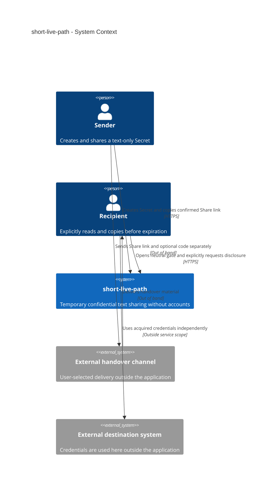
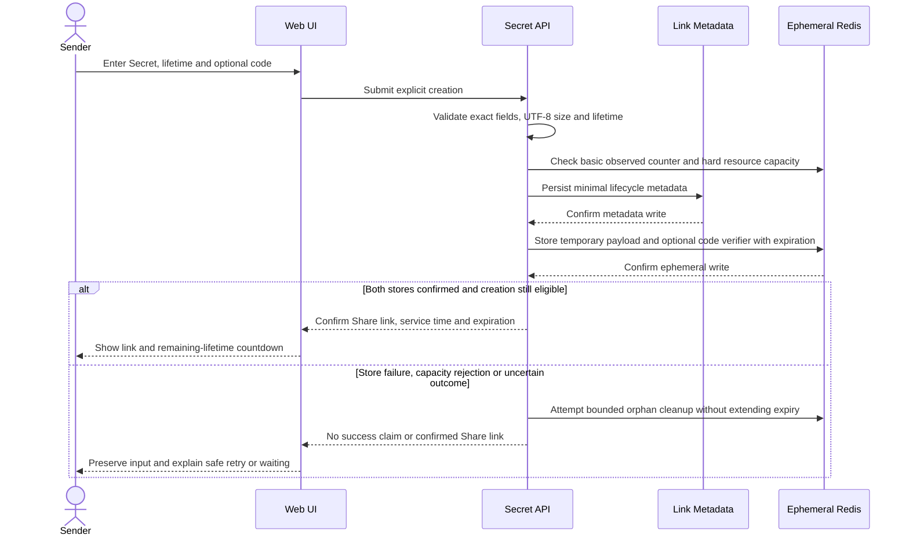
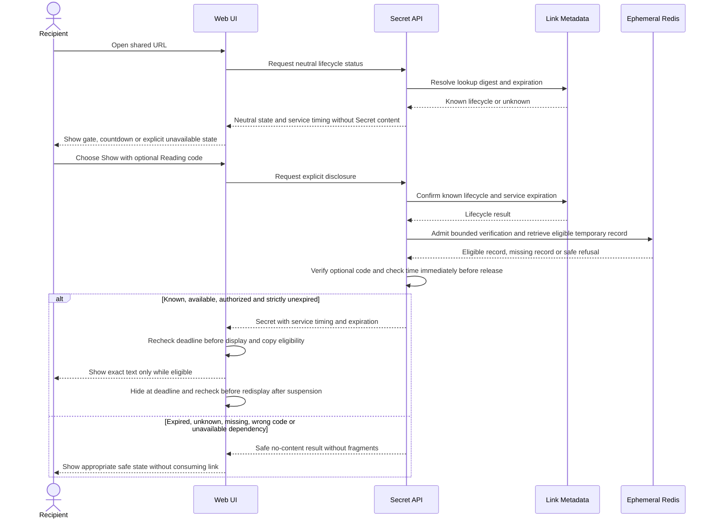
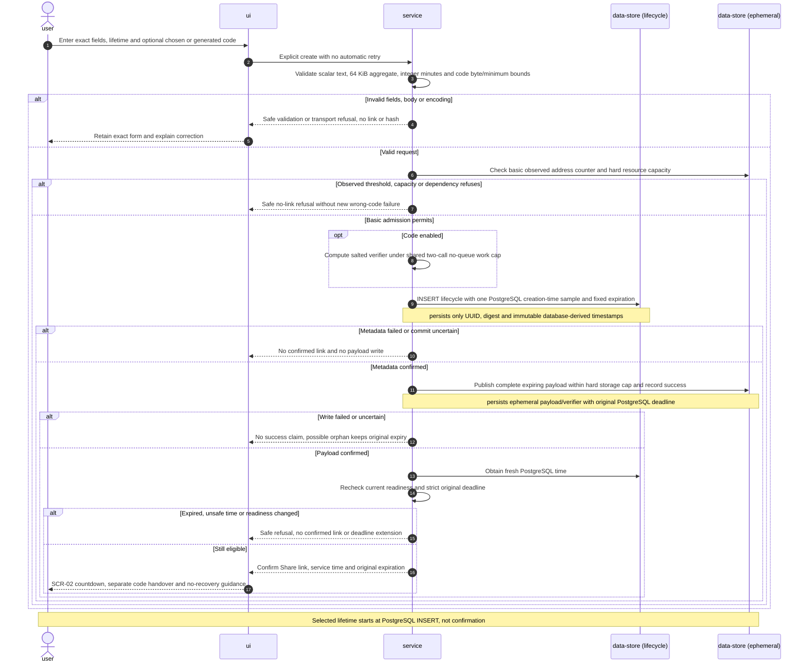
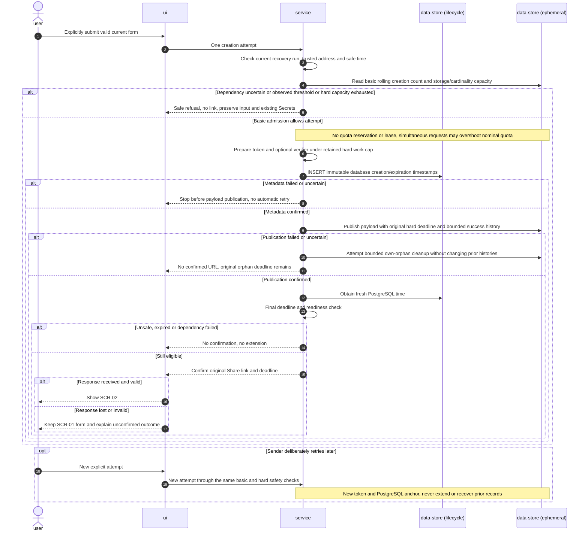
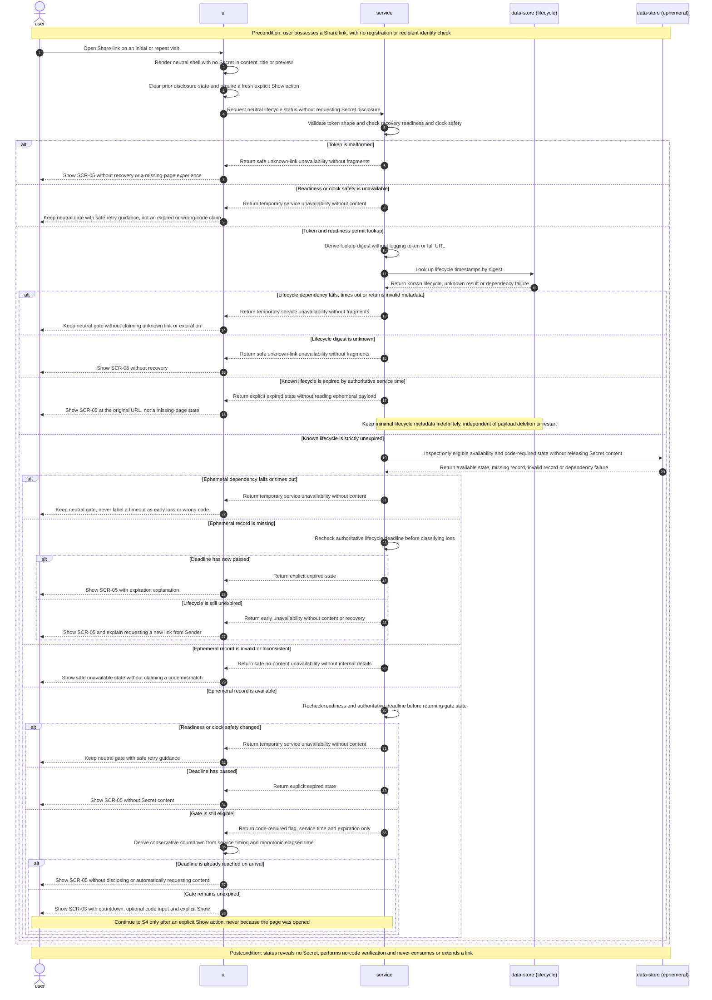
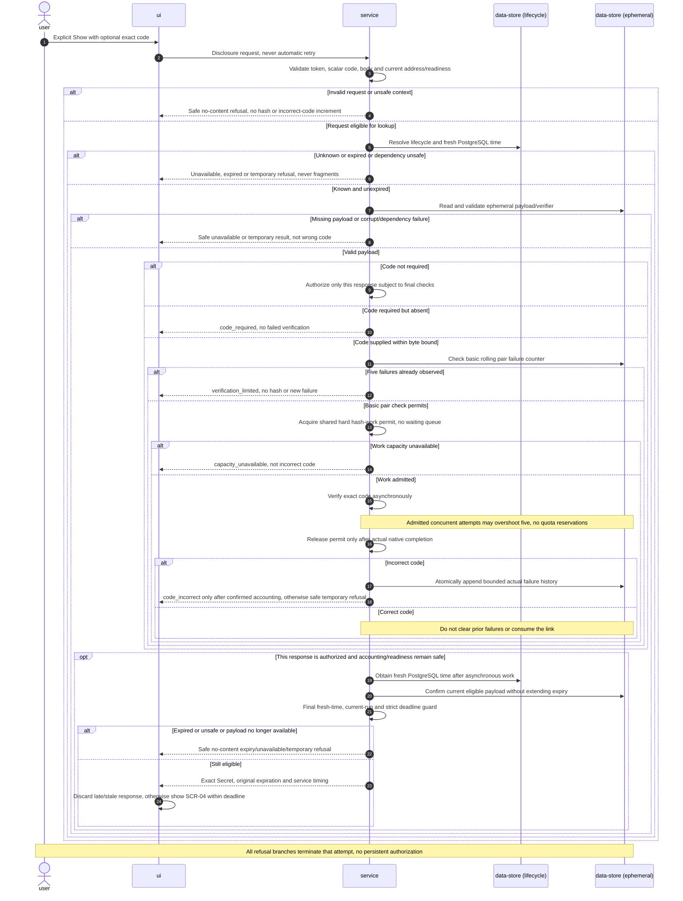
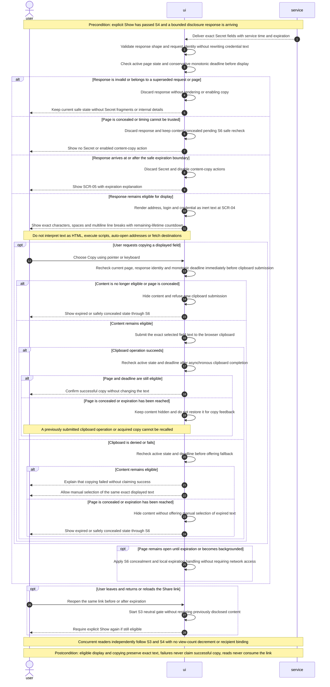
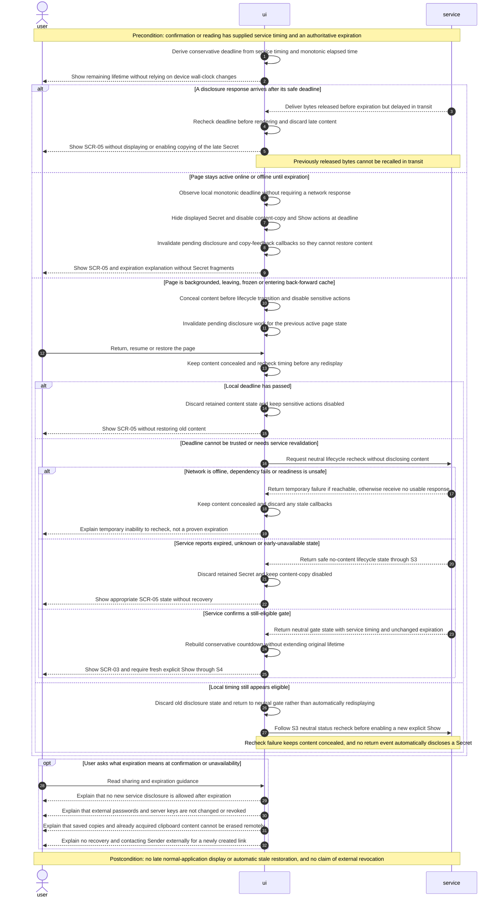
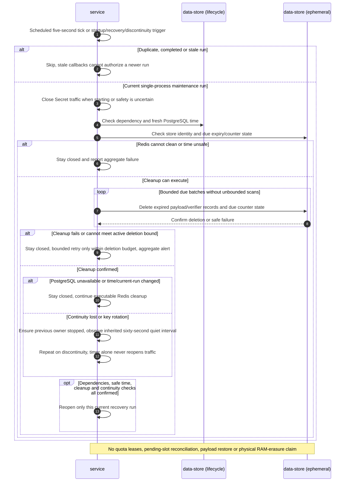

# Software Architecture Document — short-live-path


## 1. Introduction and goals


**Intent.** Enable a Sender to share a text-only Secret anonymously through a temporary Share link, and a Recipient to read it repeatedly before expiration, optionally using a separate Reading code. Preserve exact credential text without introducing accounts, history, recovery, file transfer, early removal or external credential revocation. Sources: spec §§1–6 and CONTEXT.md.

**Top-3 quality goals (ordered; full scenarios in §10):**

1. Confidentiality and bounded retention: HTTPS transport; server processing and live operator access are accepted, but no Secret content or Reading codes enter logs, analytics or backups, no full Share link is logged, and no persistent Secret copies are allowed (revised NFR-04).
2. Expiration and erasure: no new service release at or after expiration; no late display in the normal application; active Secret data removed within 60 seconds while Redis can execute cleanup; expired records cleared before Secret traffic resumes after suspension/hang, without a physical RAM-erasure deadline during that suspension/hang (revised NFR-03). Earlier loss on crash/restart is allowed; confidentiality takes priority over recovery.
3. Usability and performance: preserve exact text; p95 at most 2 seconds at 10 operations per second for Secret text up to 64 KiB; usable from 360 pixels wide with keyboard-operable primary actions (NFR-01, NFR-06). Availability of at least 99.5% per calendar month remains mandatory (NFR-02), not grounds to weaken the first two goals.

All other acceptance criteria and NFRs remain mandatory regardless of ranking.

**Stakeholders.**

| Role | Interest | Sign-off owner? |
|---|---|---|
| Sender | Anonymous creation, confirmed expiration and separate handover of link/code | No |
| Recipient | Explicit repeat reading and copying before expiration; safe unavailability | No |
| Product Owner | Product scope and accepted trade-offs; not an application role | Yes — product decisions |
| Tech Lead | Architecture, failure behavior and feasibility | Yes — architecture |
| Security Lead | Cryptography, key handling, retention and abuse review | Yes — security; review still required |


## 2. Constraints


**Technical.**
- Prescribed stack: TypeScript, AdonisJS 7, Next.js App Router, pnpm and Docker Compose. No application source, package manifests, lockfiles or Compose configuration existed at discovery; these are constraints, not installed or verified dependencies. Exact remaining versions must be pinned before implementation.
- Redis is selected for ephemeral Secret storage with disk persistence and backups disabled, under the revised server-readable model approved by Product Owner. This is an explicit exception to the PostgreSQL-source-of-truth/Redis-cache-only baseline, not proof of outage erasure. PostgreSQL stores minimal link lifecycle metadata indefinitely for now: lookup digest and creation/expiration times only, never Secret content, code hashes, plaintext codes, raw link tokens or full Share links. Exact Redis/deployment controls and resource budgets still require resolution and verification.
- Both applications remain in this repository under backend/ and frontend/, explicitly approved for this project. Generic baseline statements that they live in separate repositories do not apply; paths in each baseline are relative to its application directory.
- Secret content and optional Reading codes may be submitted to the backend over HTTPS. Browser encryption and fragment-carried content keys are not required. Neutral shells do not embed content; typed browser API calls perform creation and explicit disclosure without sensitive SSR caching. Storage must independently address expiration, retained copies and outage erasure.

**Organisational.**
- Implementation is planned collaboratively by the Product Owner and coding agent, without an additional staffed team being identified. Tech Lead and Security Lead denote review responsibilities; no independent human reviewer has been confirmed.
- Product Owner preference: implement during the current overnight working session. This is an aspirational delivery target, not a hard deadline or permission to weaken security requirements. No fixed effort budget or exact cutoff time has been supplied.
- Security/retention design blockers must be resolved before implementation readiness can be claimed; the overnight target does not waive review or verification.

**Conventions.**
- Backend: [AGENTS.md](../../../backend/AGENTS.md) and [architecture.md](../../../backend/docs/architecture.md); Controller → Service → Lucid Model for database-backed paths, thin controllers, service-owned business rules, no repositories by default. Any approved alternative Secret store requires an explicit documented exception rather than fictitious Lucid persistence.
- Frontend: [AGENTS.md](../../../frontend/AGENTS.md) and [architecture.md](../../../frontend/docs/architecture.md); thin App Router routes, typed API access in data/, framework-free entities/, UI in view/ and reusable primitives in shared/. Server Components are the default for nonsensitive shells, not for Secret processing.
- Preserve the versioned OpenAPI integration boundary and success envelope { data, meta }; errors use { error: { code, message, details } }. Feature endpoints are defined by the api stage, not invented here.
- Existing layering presets are baseline artifacts, not verified active lint gates. Tests must cite the AC they cover.

**Regulatory / external.**
- Confidential credential data; no jurisdiction-specific certification or legal compliance regime has been supplied or claimed.
- Spec §6.1 and NFR-03/NFR-04 govern confidentiality, expiration and retention. Secret payloads and Reading code verifiers are excluded from backups and disk persistence. Minimal PostgreSQL link lifecycle metadata is intentionally durable and distinct from Secret records; indefinite retention is explicitly approved, while backup scope for metadata is resolved in deployment design. The approved sixty-second active-record deletion bound applies while Redis can execute cleanup, not to physical RAM erasure during suspension/hang. Recovery clears expired records before Secret traffic resumes. TTL alone is not a bounded active-cleanup proof; explicit cleanup, recovery gating, snapshots, replicas, swap, crash dumps and retained copies require implementation and verification.
- Expiration does not revoke external credentials or erase Recipient-controlled copies. Security review remains required.

## 3. Context and scope


A Sender creates a temporary Share link for a confidential text-only Secret; a Recipient opens a neutral page and explicitly requests disclosure, with a separate Reading code when enabled. The service does not provision, connect to, validate or revoke the external access described in the Secret. Delivery of the link/code occurs outside this application without an integrated messaging provider.

<!-- brownfield: N/A — greenfield repo; independent exploration found baseline documents and lint presets, but no application source, manifests, lockfile, Compose configuration or architecture map. -->

**External systems (in / out):**

| Actor or system | Type | Interaction |
|---|---|---|
| Sender | Person | Creates a Secret and copies its confirmed Share link; sends optional Reading code separately |
| Recipient | Person | Opens a neutral gate; explicitly shows and copies available Secret text; may return before expiration |
| External handover channel | External system, contextual only | Sender-selected channel carries link and separately communicated code; no application integration or provider selection |
| External destination system | External system, contextual only | Recipient uses acquired credentials outside the service; the service never contacts it or revokes its credentials |

**Trust boundaries.** The service may receive and read Secret content and optional Reading codes over HTTPS; live operator access is accepted. There is no browser-only decryption-key boundary. A complete Share link is a credential, not proof of identity. No identity provider, account or ownership-management API is introduced. One URL may be shared with multiple readers. Durable minimal lifecycle metadata permits explicit expired states independently of Redis availability; a visible countdown derives from service-established time. Out-of-band channels and external destinations are outside the confidentiality/retention guarantee; recipient copies cannot be revoked. Redis and any other selected internal datastore belong to the container view, not external business integrations.

**C4 Context (L1), confirmed by Product Owner:**



## 4. Solution strategy


**Approved strategic decisions (implementation details continue in §§5–8).**

1. **Build web-frontend and backend-service** — One responsive browser interface supports Sender and Recipient on mobile and desktop; AdonisJS provides service-controlled expiration and abuse enforcement. Both applications live in this repository. See ADR-0001.
2. **Use a neutral Next.js shell and a server-readable ephemeral service** — Neutral shells and interactive browser forms remain; typed API clients submit content and optional Reading codes over HTTPS to AdonisJS. No client-side content encryption or key fragment is required. Sensitive browser state stays in page memory without localStorage, IndexedDB, automatic drafts or sensitive service-worker caches. Repeat visits begin at the neutral gate. ADR-0003 supersedes ADR-0002’s operator-blind requirement.
3. **Store Secrets only in ephemeral Redis** — No disk persistence, Secret backups or PostgreSQL Secret rows. Check expiration immediately before release independently of Redis cleanup. Optional Reading code verification occurs server-side; an incorrect code does not consume a link. The code is stored as a verification hash, not plaintext. Use a basic observed-counter threshold of five failures per rolling sixty-second link/address pair; deny when five failures are observed, without extending timestamps on rejected requests. Concurrently admitted attempts may overshoot under ADR-0009. Other addresses remain eligible, and no permanent or link-wide lockout is introduced. Shared-NAT readers share the pair limit. This is basic online protection, not protection against distributed guessing. ADR-0009 retains the hard two-call/no-queue verifier budget and defers exact per-pair quota reservations.

**Creation limit (Product Owner amendment):** ADR-0009 retains a basic 25-observed-successes per rolling sixty-second address threshold and the five-observed-failures link/address threshold. Already-admitted concurrent operations may overshoot; exact ceilings/reservations are deferred to backlog T22. Office readers share a public-address counter. This does not relax 1000 active payloads, Redis 256 MiB/noeviction, 10000 counter identities, five-minute counter retention, input/hash bounds, exact code verification or expiration. No automatic retry, speculative link or deadline extension is allowed.

4. **Persist minimal link lifecycle metadata indefinitely for now** — PostgreSQL stores only a lookup digest of the unguessable link token and creation/expiration timestamps. Content and code verifiers stay exclusively in ephemeral Redis. Known expired URLs remain usable for an explicit expired message, not a 404; known unexpired records with missing Redis payload show early unavailability. Confirmation and reading experiences display a service-time-based remaining-lifetime countdown. Indefinite metadata retention is approved for now and may be revised later, without implying indefinite Secret retention. See ADR-0005.

**Approved T2 amendment (2026-10-22):** ADR-0008 anchors lifetime/time in PostgreSQL and ADR-0009 explicitly defers exact concurrent quota reservations. Expected legitimate usage is about five people/day, not proof of abuse safety or a changed NFR-01 target.

**Accepted T1 starting values (2026-10-22):** ADR-0006 fixes initial Argon2id/input/work budgets and ADR-0007 fixes trusted-address/HMAC/continuity policy by explicit Product Owner approval. T1 accepted spec/API policy synchronization is complete; actual versions/topology are pinned during implementation/deployment. Benchmark calibration is T21 after backend scaffold T3 and gates final T20, not scaffolding. Acceptance is not independent security approval or measured performance.

**Pending decisions:** The approved baseline is ADR-0008 PostgreSQL creation/time plus ADR-0009 basic limits and deferred exact quota reservations. Runtime clock/sleep handling, safe publication and bounded cleanup are implementation/test obligations in T7/T8/T9/T12, not permission to serve without verification. Exact quota leases/cross-process reconciliation are outside the v1 DAG. No runtime/security readiness is claimed by approval.

**Decision override:** Product Owner withdrew the earlier operator-blind encryption requirement and approved server-readable processing, while retaining the optional Reading code, no-sensitive-log/backup rules and expiration/erasure guarantees. Earlier sections and upstream spec are synchronized rather than leaving contradictory approved requirements.

**Decision override (retention):** Product Owner accepted a scoped active-record deletion guarantee: within sixty seconds while Redis can execute cleanup; no physical RAM-erasure deadline during process/VM suspension or hang; expired records cleared before Secret traffic resumes after recovery. No disk persistence, Secret backups or recovery is introduced. Deletion does not claim forensic RAM zeroization.

## 5. Building block view


Use the prescribed layered applications, not microservices. Thin AdonisJS controllers validate and delegate to services; services own lifecycle rules, Redis access and Lucid metadata operations. PostgreSQL is authoritative for durable link lifecycle metadata; Redis is authoritative only for ephemeral payload availability and bounded admission/abuse counters, an explicit exception to the baseline cache-only rule. The browser uses typed data-layer clients and renders Secret text as inert text, never HTML or a redirect. No recipient identity/list or ownership-management module is introduced.

**Internal decomposition (planned paths, not existing code):**

```
backend/
  app/controllers/       creation, neutral status and explicit disclosure boundaries
  app/validators/        exact text, UTF-8 size, lifetime and code validation
  app/services/          lifecycle orchestration, Redis admission/cleanup and code verification
  app/models/            Lucid link lifecycle metadata only
  app/middleware/        safe errors, trusted client address and admission controls
  database/migrations/   minimal durable metadata schema, paired rollback implications
  start/                 routes and runtime wiring
frontend/
  src/app/               thin neutral routes, layouts and metadata
  src/data/              typed API access and DTO mapping
  src/entities/          framework-free lifecycle and Secret types
  src/view/              create form, share confirmation, reading gate/content/unavailable states
  src/shared/            generic controls, safe text/copy utilities and countdown timing helpers
```

**Ownership and invariants.** Web UI presents SCR-01 through SCR-05, exact copying and service-time-derived countdowns. Secret API owns the versioned contract, safe status distinctions, reading authorization, deadlines, cleanup and recovery gates. Link Metadata keeps only token lookup digests and creation/expiration timestamps indefinitely for now; it must not imply payload availability. Ephemeral Redis alone holds payloads and code verifiers and may lose them on restart. A known expired link always resolves to an expired page; unknown links are safely unavailable, and known unexpired links missing payloads are early-unavailable. Concrete cross-store ordering and failure branches are resolved in §6, not hidden behind a nonexistent distributed transaction. All browser/server responses containing content are noncacheable; detailed controls are in §§7–8.

**C4 Container (L2), revised to the confirmed PostgreSQL metadata decision:**


Confirmed boundaries after Product Owner amendment: one responsive Web UI, one Secret API, one dedicated ephemeral Redis instance and PostgreSQL for minimal lifecycle metadata. No PostgreSQL Secret content or code-verifier store, external messaging integration, queue or separate worker deployable. The API owns cleanup scheduling and recovery readiness, so it is not a fourth surface. The reverse proxy routes the public API prefix directly to AdonisJS; Next.js renders only neutral shells and does not act as a sensitive-data relay. Concrete runtime controls and route contracts remain §§7–8 and the api stage.

## 6. Runtime view


The primary runtime flows below reflect the approved server-readable model. Participants are the §5 containers; messages are semantic rather than endpoint contracts.

**Critical flow 1: create and confirm.**



**Creation ordering and partial failure.** Prepare optional code hashing within the retained process-wide work budget, then sample PostgreSQL creation/expiration once in the lifecycle INSERT. Confirmed metadata precedes payload publication with that same hard deadline; commit/Redis/response delay reduces usable lifetime. Uncertain metadata means no payload write or link; uncertain Redis means no success claim or automatic retry. Possible orphans keep original expiry and bounded cleanup. Counter checks are basic observed-state checks, not reservations or a distributed transaction; exact concurrent quota accounting is deferred by ADR-0009.

**Critical flow 2: neutral status, explicit disclosure and expiry.**



**Approved state/failure policy.** Known expired links use PostgreSQL metadata to show expired even if Redis data is gone. Known unexpired metadata with a missing Redis record means early unavailability. Unknown links are safely unavailable. A dependency timeout is temporary service unavailability, never evidence of expiration, an unknown link or an incorrect code. If either required store is unavailable, disclosure fails closed; there is no alternate read path that bypasses checks. The diagram abbreviates failure exits: after a metadata rejection or dependency failure, stop before optional verification or further store calls. Neutral status never releases content. No visit or successful read consumes a link, including concurrent reads.

**Time and disclosure.** PostgreSQL provides authoritative service time. Obtain fresh time after asynchronous verification and check the immutable deadline immediately before bounded nonstreaming release; unsafe/backward time or stale readiness fails closed. Conservative monotonic elapsed-time handling must not turn an old sample into permission. Browser timing accounts for transit, hides offline at expiry, conceals background return and requires neutral revalidation plus explicit Show. T8/T12 must implement/test clock rollback, sleep and late response vectors before serving Secrets. Previously released bytes/copies cannot be recalled.

### T1 transport and admission refinements

Accepted ADR-0006/0007 refine the S1/S2/S3/S4/S7 prose branches without adding endpoints or deployables. Before parsing/expensive work, creation and disclosure admit only application/json with absent or identity Content-Encoding and at most 524288 wire bytes, including chunked/unknown-length bodies. Oversized body maps to 413 short_live_path.request_too_large; unsupported media type or compression maps to 415 short_live_path.unsupported_media_type. Both use the safe error envelope, no-store/no-referrer and no submitted-value echo. Reject malformed/oversized scalar Reading codes with 422 short_live_path.invalid_request before hashing (maximum 1024 UTF-8 bytes, create minimum six code points); no truncation, wrong-code increment or confirmed link. Proxy/API limits must agree; GET status accepts no body and is not a hash-work admission path.

Global hash saturation (two concurrent calls/no queue) is 503 capacity_unavailable, not pair 429 or wrong-code 403. Retain the native-work permit through actual completion after timeout/disconnect. Process-local native-work admission remains mandatory; exact quota reservations are deferred by ADR-0009. Proxy trust/canonicalization/HMAC/continuity follow ADR-0009 (inherited from historical ADR-0007); do not expose forwarding headers as client-settable API parameters. Invalid/untrusted address context, continuity recovery or incomplete fencing fails closed with 503 service_unavailable on Secret operations. Failures cannot clear prior histories, bypass admission or publish payloads. T8/T12 implement and test current-process time/recovery guards before sensitive traffic; exact quota reservations remain deferred backlog T22. T17/T18 verify actual proxy/key configuration and faults.

### S1. Create with lifetime and optional Reading code

Coverage: US-01, US-02, US-03; AC-01, AC-02, AC-04, AC-05, AC-06. Screen path: SCR-01 to SCR-02 only after confirmed success. Status: confirmed in prose by Product Owner.

The design seeds and S1/S2/S4/S7 were revised to the approved ADR-0008/0009 baseline. Additional runtime diagrams use generic participants mapped to §5: user (Sender or Recipient), ui (Web UI), service (Secret API), data-store (lifecycle metadata) and data-store (ephemeral payloads and admission state). The two store roles are not a distributed transaction or new building blocks. No external delivery integration is introduced.



**Timing and scope obligations.** Expiration is the chosen interval after the PostgreSQL lifecycle INSERT (ADR-0008), not after final confirmation. Prepare the optional verifier before INSERT; sample database-derived millisecond timestamps once and never republish them. Commit/Redis/response delay consumes lifetime; no one-second release grace is implied. Lost confirmation and uncertain writes produce no link, auto-retry or deadline extension. Exact concurrent quota reservation is deferred by ADR-0009; input/hash bounds remain mandatory.

### S2. Creation admission, partial failure and manual retry

Coverage: US-01 and US-02; AC-01/AC-04 confirmation integrity, AC-11 orphan retention and NFR-05. Screen path: refusal or uncertainty stays at SCR-01. Status: confirmed in prose by Product Owner.



**Admission and failure semantics.** Basic admission checks 25 observed successes per rolling sixty-second address window; already-admitted concurrent requests can overshoot. Keep 1000 active Secrets, Redis 256 MiB/noeviction and 10000 transient counter identities, with safe refusal rather than eviction. Address/pair state uses retained keyed pseudonyms and expires within five minutes of last relevant request. No v1 quota reservations/leases or pending-slot registry exists. Known refusal yields no link; uncertain writes do not prove absence, and every possible payload retains its original hard deadline. Immutable metadata is not deleted as rollback. Manual retry is a fresh attempt, never recovery or extension.

### S3. Open a neutral gate and resolve safe lifecycle states

Coverage: US-04 and US-05; AC-04 countdown, AC-08, AC-09 and AC-11b. Screen path: initial and repeat visits enter SCR-03 without content, or SCR-05 for terminal unavailability. Status: confirmed in prose by Product Owner.



**Status boundaries.** Neutral status does not decrement a view count, verify a Reading code, change expiration or persist a recipient identity. Read-only availability inspection is not permission to serialize payload fields into a status response, neutral HTML, preview, logs or cache. All status responses and sensitive routes remain noncacheable under §8. A status success is not a reservation or guarantee of later readability: S4 independently rechecks lifecycle, payload, authorization and time. Known expired metadata can produce an explicit expired state without Redis payload access while the service is otherwise ready. It does not bypass S7's closed recovery gate or turn a required dependency failure into an alternative disclosure path. A still-unexpired lost payload may follow crash/restart and cannot be restored from metadata. No read or status visit recovers an old Secret, and concurrent visitors do not compete for a view allowance. SCR-05 explains limits through S6. No new participant or persistence operation is introduced by this read-only flow.

### S4. Explicit disclosure with basic code limits and hard work bounds

Coverage: US-03, US-04 and US-05; AC-06 exact comparison, AC-07, AC-08 and AC-10 pre-release check. Screen path: explicit Show from SCR-03, with eligible content handed to S5 only on success. Status: confirmed in prose by Product Owner.



**Concurrent-attempt semantics.** Check the basic rolling pair counter before hashing and deny when five failures are observed. Already-admitted concurrent guesses may exceed five; ADR-0009 explicitly defers exact quota reservations, leases and cross-process fencing to backlog T22. Keep atomic counter updates, no failure timestamp on rejected requests, no previous-failure reset on success, no link consumption and independent address pairs. The global two-native-call/no-queue bound remains hard, including distributed attempts; a timed-out/disconnected native call retains its permit until completion. Invalid input, capacity refusal and dependency uncertainty are not fabricated incorrect-code failures. Only a correct code plus final payload/readiness/PostgreSQL-time checks authorizes that response.

### S5. Display and copy exact text, with repeat and concurrent reading

Coverage: US-04; AC-03 and AC-08, with AC-04 countdown and AC-10 browser eligibility checks. Screen path: SCR-03 to SCR-04 only for eligible disclosure, with SCR-05 on expiration. Status: confirmed in prose by Product Owner.



**Browser and copy boundaries.** Copy helpers pass the original field string without trimming, newline conversion, Unicode normalization or formatting. Manual selection is a fallback while the same text remains eligible, not a download, stored draft or recovery feature. The browser clipboard is an existing browser capability owned by ui here, not a new external integration or §5 building block. Clipboard submission is guarded before it starts and asynchronous feedback is guarded again afterward: a submitted write that completes after expiration cannot be canceled reliably, and already acquired copies remain outside revocation guarantees. No late callback may redisplay expired content. Secret/code state is limited to current page memory, never localStorage, IndexedDB, service-worker caches, server-rendered payloads or analytics. S6 defines offline expiry, background concealment and return handling. Service checks still apply on every fresh Show even if this browser previously displayed the same Secret. Shared-address code throttling in S4 can temporarily refuse concurrent verifications, but successful reading never consumes a link or imposes an exclusive reader. No persistence operation or new participant is introduced.

### S6. Expiration, late responses and safe return to the page

Coverage: US-02, US-04 and US-05; AC-04 service-derived countdown, AC-10 and AC-12. Screen path: eligible SCR-02/SCR-03/SCR-04 timing, with SCR-05 at expiration and a neutral SCR-03 gate after a safe eligible return. Status: confirmed in prose by Product Owner.



**Time and lifecycle obligations.** The countdown is presentation, not permission. PostgreSQL-derived expiration and fresh service timing govern final release and conservative browser deadlines; device wall-clock changes cannot extend the window. Hide locally offline and on background/pagehide/freeze; invalidate stale asynchronous display/copy callbacks. On return, stay concealed until neutral revalidation and a fresh explicit Show. T8/T12 own runtime clock/transit/sleep tests before serving; representative profiles remain due before plan-tests. No promise covers modified clients or Recipient copies.

### S7. Bounded cleanup and recovery before serving

Coverage: US-05 and US-04 early loss; AC-11, AC-11b and the cleanup/recovery part of AC-10; NFR-03/NFR-04. This is an internal service flow, not a new user screen or separately deployed worker. Status: confirmed in prose by Product Owner.



**Asynchronous maintenance and failure handling.** The service's own scheduled loop is the trigger and handler, not an external scheduler, message bus or worker surface. Check a run identity/ownership key first to suppress duplicate runs, while idempotent deletion and current recovery fencing make replay safe. A completed old run must never authorize a newer recovery generation. The dead-letter branch means a failed maintenance-run state and aggregate alert inside the existing service, not a durable payload queue or a new datastore entity. N, backoff, run-key/ownership representation and recovery-fencing details are unresolved technical parameters within §11's cleanup/recovery algorithm obligation, not approved numbers or a schema commitment. Retries remain bounded by the active deletion deadline, and exhaustion must not be silently treated as successful cleanup. Continued recovery attempts do not reopen traffic before a confirmed sweep. Alerts and failure records contain no Secret, code, raw token, full URL or address.

**Retention and outage boundaries.** The <=60-second active-record deletion bound remains mandatory while Redis can execute cleanup. TTL, a five-second tick or a fail-closed API alone is not proof; T8/T18 must test cleanup under faults and capacity. No physical RAM-erasure deadline applies during suspension/hang. Startup/recovery closes traffic, establishes current single-process ownership and safe PostgreSQL time, clears expired records and only then reopens. Continue possible Redis cleanup during PostgreSQL outage. Lost payloads are never reconstructed. Address/key continuity keeps ADR-0009 quiet-window recovery, while exact quota reservation reconciliation is deferred.

**Non-runtime verification for AC-11 and NFR-04.** Audit and canary-test protected transport, proxy/app/datastore/telemetry logging, cache exclusions, metadata-only backups and restore, disabled Redis persistence, swap/dumps and infrastructure snapshot paths as specified in §§7–10. These configuration/security checks are required in addition to the runtime branches above. A diagram, successful deletion or an expired UI does not prove that no sensitive copies reached logs, disks or backups. No new §5 participant is needed and no new ADR is automatically created.

### Runtime coverage and stage review

Size M and route standard are read from .size and .route. The flow list and AC coverage plan were accepted before drafting. Product Owner then confirmed S1 through S7 individually in prose, without requested edits, deferrals or drops. The original two design seed blocks remain unchanged and precede the additive S1–S7 blocks. New flows are ordered by creation, reading and expiration, with cross-cutting creation failure after S1 and maintenance after the user-facing expiration flow.

| Source | Runtime coverage | Branch or verification boundary |
|---|---|---|
| US-01 | S1, S2 | Anonymous creation, validation, confirmed sharing and safe refusal/retry |
| US-02 | S1, S2, S6 | Whole-minute lifetime, PostgreSQL-write creation anchor and service-derived countdown |
| US-03 | S1, S4 | Optional code choice/generation, exact verification and concurrent failure admission |
| US-04 | S3, S4, S5, S6, S7 | Neutral visits, explicit repeated/concurrent reading, exact copy and early loss |
| US-05 | S4, S6, S7 | Final release boundary, browser hiding, scoped cleanup and expiration limits |
| AC-01 | S1, S2 | Confirmed link and expiration only on received success, without registration |
| AC-02 | S1 | Missing/whitespace-only credential and UTF-8 total above 64 KiB refuse with no link, valid text preserved |
| AC-03 | S5 | Inert exact text and clipboard strings preserve characters, spaces and line breaks, with safe manual fallback |
| AC-04 | S1, S2, S3, S5, S6 | Default sixty minutes, every integer from one through 1440, no silent rounding, PostgreSQL-write creation anchor and countdown independent of device wall clock. Exact slider interaction remains a screens obligation |
| AC-05 | S1 | Fractional/out-of-range lifetime refuses creation with explained bounds |
| AC-06 | S1, S4 | Optional code, six Unicode code-point minimum, longer codes, nonblocking weak-code guidance, secure twenty-character generator, separate handover and exact comparison. Resource budget follows Accepted ADR-0006; T21 calibration remains |
| AC-07 | S4 | No fragments on missing/wrong code, salted verifier only, basic rolling five-observed-failure pair check, acknowledged concurrent overshoot, no refusal extension or permanent/link-wide consumption |
| AC-08 | S3, S4, S5 | Every visit is neutral until explicit Show, no account, repeat/concurrent reading allowed without consumption |
| AC-09 | S3 | Known expired original URL stays explicitly expired using retained metadata, unknown safely unavailable, known unexpired missing payload explicitly early-unavailable |
| AC-10 | S4, S5, S6, S7 | Immediate final service-time check, no late display, offline hiding and concealed resume/revalidation, no recall of already released bytes |
| AC-11 | S7, S2 | Bounded active deletion and orphan expiry, recovery sweep before serving, no physical erasure deadline during suspension. Log/backup/persistence exclusions additionally require the explicit non-runtime infrastructure and canary checks under S7 |
| AC-11b | S3, S7 | Lost unexpired payload reveals nothing, cannot be restored, and requires a new link from Sender |
| AC-12 | S6 | Explain that expiration neither revokes external credentials nor erases Recipient copies |

**Data-model handoff.** Durable LinkLifecycle timestamps are immutable from the PostgreSQL INSERT. Ephemeral payload/verifier storage retains the same expiry; basic bounded creation/failure counter histories have no pending reservation fields. Payload/limiter expiry indexes support bounded cleanup. Exact quota leases/registries are deferred backlog T22; no persistent maintenance table or payload backup is introduced.

**Flagged technical decisions.** ADR-0008/0009 record the approved time/creation and simplified quota baseline. Runtime clock/deadline, safe publication, cleanup and current-run protections must be implemented/tested before sensitive traffic. Exact concurrent quotas are intentionally deferred, not a hidden pre-scaffold or launch gate. Browser/network profile and actual deployment inputs remain explicit follow-ups. Documentation validation is not an application/security/performance result.

**Structural self-check: PASS.** The current ADR-0008/0009 amendment updates creation/admission/disclosure/recovery flows and their prose while retaining all thirteen AC IDs and S1–S7 coverage. All eleven Mermaid blocks parsed and rendered with mermaid-cli 12.0.0 and installed Chrome; refreshed S1/S2/S4/S7 PNG artifacts have valid signatures and nonzero dimensions. Existing historical review/spawn logs describe the earlier design pass, not this later amendment. These checks prove document structure only, not runtime clock, cleanup, quota or security behavior.

## 7. Deployment view


**Topology.** Initial deployment uses one host and Docker Compose: HTTPS reverse proxy, Next.js Web UI, one AdonisJS Secret API replica, PostgreSQL Link Metadata and a dedicated ephemeral Redis instance. Only HTTPS is public; PostgreSQL and Redis are private services. Domain, host sizing and exact image versions are not supplied and must be pinned before deployment. This topology is approved, not deployed or benchmarked.

PostgreSQL uses a persistent volume and metadata-only backups. Redis has no persistent volume, AOF, RDB save schedule or Secret backups; disable save-on-shutdown and external Redis/VM memory snapshots. Configure the approved 256 MiB Redis maxmemory with noeviction. Secret content and code verifiers must not reach PostgreSQL, logs, disk persistence, backups or monitoring. Host swap and process/core memory dumps are disabled, and VM/host suspend-with-memory or memory-inclusive snapshot paths must be excluded and audited before launch. Metadata backup restoration never restores Secret payloads; Redis starts empty after restart.

**Lifecycle and readiness.** Run API-owned bounded cleanup every five seconds. Close traffic on startup/reconnect/unsafe time or runtime discontinuity; establish one current process/run, check dependencies and PostgreSQL time, clear expired payloads and only then reopen. Stale callbacks cannot reopen a newer recovery run; API owners must not overlap. Continue executable Redis cleanup during PostgreSQL outage. Same-key surviving counters remain; continuity loss/key rotation retains old-owner shutdown plus the >=60-second quiet interval and cleanup (ADR-0009). There is no v1 quota-lease reconciliation. T8/T18 must prove the unchanged cleanup/expiry guarantees before launch.

**Monitoring (aggregate only).**
- Service and dependency readiness, external disposable synthetic creation/read checks, operation latency and failures; use NFR-01/NFR-02 targets without treating configured values as measured results.
- Active Secret count versus 1000, Redis used/max memory, capacity/creation/code-limit rejections, verifier queue/concurrency and counter cardinality.
- Cleanup last-success age, oldest expired active record, cleanup batch failures and recovery duration. Page on any observed expired release, late display or deletion violation; fail readiness if bounded cleanup cannot be assured. Any concrete early-warning threshold must be below the sixty-second bound and validated under load, not used to relax that bound.
- Instrument OpenTelemetry/Prometheus/Grafana with allowlisted attributes and route templates only. No request/response bodies, code/token values, raw paths containing credentials, client addresses, browser session replay or sensitive exception locals. Monitoring components are operational dependencies, not additional product surfaces.

**Capacity and scaling.** Keep one API/cleanup owner initially; do not add replicas without reviewing cross-instance admission, cleanup ownership, recovery fencing and clock behavior. At 1000 active Secrets, counter-cap exhaustion or Redis memory refusal, reject new creation safely rather than evicting existing Secrets. The 256 MiB budget is initial configuration, not a guaranteed process RSS ceiling or throughput result; Redis overhead and container/host headroom must be measured. PostgreSQL metadata grows indefinitely under the approved policy and requires disk-growth monitoring; do not introduce automatic metadata deletion silently. Scale/resize only after measured bottlenecks and verification of the same retention/access contracts.

**Availability trade-off.** A single host is a single failure domain. The approved 99.5% monthly target remains a target to measure, not a claim of high availability. Earlier loss of unexpired Secrets is permitted; metadata durability does not promise payload recovery. Infrastructure/backup controls and both desktop/mobile live behavior remain unverified until implementation and deployment.

 -->

## 8. Crosscutting concepts


| Concept | Convention | Where defined |
|---|---|---|
| Authorization / identity | Possession of an unguessable random Share link token, plus the optional Reading code. No accounts, recipient identity/list, JWT/session ownership or consumption on read. Generate tokens with the runtime cryptographically secure random source, never a timestamp/sequence. Exact token encoding/entropy is resolved before tasks. | Spec §6.1; ADR-0003/0005 |
| Durable lookup | PostgreSQL stores only a non-reversible cryptographic digest of the random link token and lifecycle timestamps. Token digests are not identifiers for low-entropy codes or IPs. No Secret/code/verifier/full link in PostgreSQL or its backups. | ADR-0005 |
| Reading code verification | Store a salted, password-hard verification hash in ephemeral Redis, never plaintext. Preserve exact Unicode/case/spaces without trimming or normalization; minimum six code points, generated code twenty Latin-letter/digit characters from a cryptographically secure source with unbiased sampling. Bound concurrent hash work and its queue; do not run expensive verification before admission. ADR-0006 accepts Argon2id v19, m=65536 KiB/t=3/p=4, salt 16 bytes/output 32 bytes, two concurrent calls/no queue, code <=1024 UTF-8 bytes/body <=524288 wire bytes as starting values. T1 source-contract sync is complete; T21 post-scaffold calibration remains, without measured performance approval. | AC-06/AC-07; §11 |
| Wrong-code admission | Basic rolling failure counter check against five per link/address pair; already-admitted simultaneous guesses may overshoot. No quota reservations, leases, failure reset, link consumption or window extension on rejected requests. Hard global hash-work cap remains. Exact concurrent enforcement is deferred to backlog T22. | ADR-0009; AC-07 |
| Creation admission / capacity | Basic rolling observed-success check against 25/address; concurrent overshoot is accepted. No quota reservation protocol. Enforce 1000 active payloads and 256 MiB Redis/noeviction at safe publication, preserving immutable PostgreSQL-derived expiry. Unknown writes never create a success claim. | ADR-0008/0009; NFR-05 |
| IP privacy and counter bounds | Accept forwarded client addresses only from an explicitly configured trusted proxy; never trust an arbitrary incoming forwarding header. Canonicalize addresses consistently and use a keyed cryptographic address digest with a server-held secret, not a bare hash of enumerable IP space. No IP logging or durable address records. Maximum 10,000 active limiter records globally, including pair/address counters and any future reservation units, removed no later than five minutes after last relevant request. At cap, reject operations requiring a new limiter record rather than bypassing protection; do not evict active safety state. ADR-0007 accepts stable versioned HMAC labels and a fenced >=60s quiet interval on continuity loss/rotation; Runtime single-process time/recovery guards remain implementation obligations; exact quota fencing is deferred. Actual proxy allowlist and key provisioning are deployment inputs. | Approved §8 package; §11 |
| Content and browser state | Render all Secret fields as inert text; never HTML, scripts, clickable auto-navigation or server-side URL fetching. Copy exact text and confirm success only after clipboard success; manual selection remains available while eligible. No localStorage/IndexedDB drafts, session replay or sensitive service-worker caches. | AC-02/AC-03; UX flows |
| Cache / browser headers | Apply Cache-Control: no-store to status/disclosure/creation responses and sensitive routes; no CDN/proxy/Next.js fetch or route cache for these flows. Referrer-Policy: no-referrer, no third-party analytics and a restrictive self-hosted script policy. Scrub routes before logs/traces, not after collection. Review browser history, back-forward cache and page lifecycle so expired plaintext is never deliberately redisplayed. no-store is not a promise to erase Recipient copies. | NFR-04; §§6–7 |
| Time, expiry and recovery | PostgreSQL supplies creation/time; final release after asynchronous work rechecks time/deadline/readiness. Unsafe/backward time closes traffic. Startup/recovery clears expired data before serving; stale current-process callbacks cannot reopen a newer run. Browser uses conservative monotonic deadlines and concealed revalidation. Runtime proof belongs to T8/T12/T18. | ADR-0008; AC-04/AC-10/AC-11 |
| API errors / corruption | Preserve the baseline { data, meta } success and { error: { code, message, details } } failure envelopes; the api stage assigns codes/statuses. Distinguish safe expired, early-unavailable and unknown states from temporary dependency failures. Wrong-code/corruption outcomes reveal no partial Secret or internal exception details and never consume a link. Validate stored record shape before constructing a response. | Backend architecture; AC-07/AC-09/AC-11b |
| Logging / observability | Allowlist aggregate fields and route templates at proxy, Next.js, API, Redis/PostgreSQL diagnostics and telemetry exporters. No bodies, credentials, full URLs/raw token paths, codes, client addresses or exception locals. Disable payload-bearing query/command recording, session replay and unredacted error reporting. Synthetic monitoring uses disposable canary values and reports aggregate outcomes. | Revised NFR-04; §7 |
| Events / workers | Synchronous request/service paths and an API-owned bounded cleanup loop; no queue, event bus or separate worker surface. Cross-store operations are not a distributed transaction. | §§5–7 |
| Language / accessibility | Artifact prose is English per project settings; UI language and exact browser/network matrix remain product/test-planning decisions. No invented translation or component library; retain 360-pixel minimum, keyboard actions and all minute-level lifetime choices. | NFR-06; spec §8; UX flows |

**Approval boundary.** ADR-0008/0009 are Accepted product/architecture choices, not installed code or security/performance evidence. ADR-0009 supersedes ADR-0006/0007 while retaining their input/hash/address/quiet-window protections. Runtime guards remain mandatory implementation work; exact concurrent quota reservations are deferred outside the executable v1 DAG.

## 9. Architecture decisions


| # | Title | Status | Section |
|---|---|---|---|
| 0001 | [Build a responsive web frontend and backend service](adr/0001-build-responsive-web-frontend-and-backend-service.md) | Accepted | §4 |
| 0002 | [Use a neutral Next.js server shell with browser-only Secret processing](adr/0002-use-neutral-nextjs-shell-with-browser-only-secret-processing.md) | Superseded by 0003 | §4 |
| 0003 | [Use server-readable ephemeral Secrets with an optional Reading code](adr/0003-use-server-readable-ephemeral-secrets-with-optional-reading-code.md) | Accepted; retention amended by 0004 | §4 |
| 0004 | [Scope ephemeral deletion to running cleanup and gate recovery before serving](adr/0004-scope-ephemeral-deletion-and-gate-recovery-before-serving.md) | Accepted | §4 |
| 0005 | [Persist minimal link lifecycle metadata indefinitely](adr/0005-persist-minimal-link-lifecycle-metadata-indefinitely.md) | Accepted | §4–5 |
| 0006 | [Bound Argon2id Reading code work and input](adr/0006-bound-argon2id-reading-code-work-and-input.md) | Superseded by 0009; non-quota profile retained | §§4/8/11 |
| 0007 | [Canonicalize trusted addresses and fence quota resets](adr/0007-canonicalize-trusted-addresses-and-fence-quota-resets.md) | Superseded by 0009; address/quiet-window policy retained | §§7/8/11 |
| 0008 | [Anchor lifetime and service time in PostgreSQL](adr/0008-anchor-lifetime-and-service-time-in-postgresql.md) | Accepted | §§4/6/8 |
| 0009 | [Keep basic limits and defer exact concurrent quotas](adr/0009-keep-basic-limits-and-defer-exact-concurrent-quotas.md) | Accepted | §§4/6/8/11 |

ADR files live under docs/features/short-live-path/adr/ and are indexed above. ADR-0002 is historical and intentionally superseded; its original browser-only requirement is not current.

## 10. Quality requirements


The following are approved targets and verification obligations, not results. Targets below quote the current spec §6 verbatim, including Product Owner amendments. QG-1 through QG-3 expand the ordered quality goals in §1; remaining scenarios retain all other NFRs.

**QG-1. Confidentiality and bounded persistence**
- **When:** A Sender creates a canary Secret and multiple readers open/show/copy it, followed by metadata backup and restore.
- **Then (NFR-04, verbatim):** HTTPS for all public Secret and Reading code traffic; server-side processing and operator access during retention are permitted. Zero Secret content or Reading codes in logs, analytics or backups; zero full Share links in logs. No persistent Secret copies; minimal link lifecycle metadata may persist indefinitely without Secret content, Reading code or full Share link
- **How verify:** Inspect TLS behavior and allowlisted telemetry at proxy, Next.js, API, datastore diagnostics and exporters. Search all logs, traces, analytics, cache/storage and backup artifacts for canary content, codes and raw/full links. Verify PostgreSQL contains only the approved digest/timestamps and cannot reconstruct or restore payloads. Live server/operator access is explicitly allowed, not a failed test.

**QG-2. Expiration, active-record cleanup and failure recovery**
- **When:** Requests race the expiration boundary, cleanup is delayed, the page is offline/backgrounded, or API/Redis/VM execution is interrupted and resumed.
- **Then (NFR-03, verbatim):** Zero new releases by the service at or after expiration, checked immediately before release; zero late displays in the normal application; active Secret data removed no later than 60 seconds after expiration while Redis can execute cleanup; after suspension/hang, expired records cleared before Secret traffic resumes; no physical RAM-erasure deadline during suspension/hang
- **How verify:** Use controlled boundary clocks and delayed responses, concurrent reads, browser wall-clock changes, offline timers and suspension/back-forward-cache tests. Assert the final pre-release and pre-display checks independently of Redis TTL. Inspect active payload/verifier records through expiry and the approved cleanup interval while cleanup can execute. Suspend longer than that interval and verify no physical erasure claim is made during suspension, expired records clear before Secret readiness resumes, and startup/reconnection/metadata restore cannot resurrect content. Include early loss and dependency errors, not only happy-path TTL tests.

**QG-3. End-to-end performance**
- **When:** Representative mobile/desktop browsers perform creation and reading with and without Reading codes at the approved workload and maximum text size.
- **Then (NFR-01, verbatim):** p95 at most 2 seconds at 10 operations per second for Secret text up to 64 KiB
- **How verify:** Run a reproducible end-to-end load test including HTTPS, both stores, code hashing/admission and browser display. Use enough distinct network-address/link pairs that the creation and wrong-code limits do not invalidate the throughput profile. Record workload mix, hardware, browser/network profile, error rate and p95 rather than treating rejected requests as successful low-latency operations. The exact representative profile is owned before plan-tests; no performance result is currently available.

**QG-4. Availability**
- **When:** The deployed single-host service operates through a calendar month.
- **Then (NFR-02, verbatim):** At least 99.5% per calendar month
- **How verify:** External disposable synthetic creation/read probes record eligible successes and failures and compute calendar-month availability, without real credentials or logged full URLs. Include both store dependencies and maintenance/outage periods under an explicitly documented measurement policy. A build, short soak or single recovery drill is not evidence of monthly attainment.

**QG-5. Creation abuse and overload handling**
- **When:** An office shares an address while boundary-burst and concurrent creation requests compete for quota, limiter records, payload capacity and memory.
- **Then (NFR-05, verbatim):** Basic admission threshold of 25 successful creations per rolling 60-second network-address window; an exact ceiling under concurrent requests is not promised in v1
- **How verify:** Test the twenty-fifth success and twenty-sixth attempted success within a rolling window, exact release at the oldest success boundary, basic observed-counter rejection, acknowledged simultaneous-request overshoot, store timeouts and manual retries. Exact concurrent quota ceilings are deferred; still assert no confirmed link on refusal. Verify input remains in the page. Exercise approved active-payload/memory/counter caps and noeviction with deterministic capacity injection; failed allocations must not evict existing Secrets or bypass protection.

**QG-6. Accessible interface**
- **When:** Sender and readers use narrow mobile and desktop screens and keyboard-only primary flows.
- **Then (NFR-06, verbatim):** Usable from 360 pixels wide; all primary actions keyboard-operable
- **How verify:** Exercise SCR-01 through SCR-05 with the supported browser matrix once fixed before plan-tests. Verify focus, labels, visible errors, Show/copy/manual-copy behavior and all whole-minute lifetime values with hour-snapping assistance. Code/generator controls and service-derived countdown must remain usable without pointer-only interaction.

**QG-7. Domain and safety invariants (acceptance criteria and approved design budgets, not new NFR targets)**
- **When:** Multiple people receive the same link and optional code, repeatedly/concurrently read exact multiline credentials, encounter wrong codes, reload or revisit expired/early-lost/unknown links.
- **Then:** No recipient identification or read consumption; exact UTF-8 field contents and line breaks; neutral initial gate and explicit Show; a basic five-failure rolling-minute link/address threshold without permanent lockout and without an exact concurrent ceiling; 1000 active Secrets, 256 MiB Redis and 10,000 limiter records with safe refusal; limiter records removed within five minutes of the last relevant request. PostgreSQL retains minimal lifecycle metadata indefinitely for now. Confirmation/reading show remaining lifetime and known expired URLs show an explicit expired state, not a missing-page/404 experience. These values come from AC-02/AC-06/AC-07/AC-09 and approved §§4–8, not an invented NFR-01 target.
- **How verify:** Byte-for-byte multibyte/multiline round trips and clipboard assertions, generation/code exactness tests, basic pair checks, acknowledged concurrent overshoot and hard global work admission, mocked memory/counter exhaustion and retention checks, known-expired versus unknown versus early-lost versus dependency-failure UI tests. Confirm lost creation responses never trigger automatic retry or extend old expiry and that any unreachable record follows the same cleanup policy. Review backup contents and metadata restoration separately from forbidden payload recovery.

**Measurement status.** None of these tests has run against an application: no source/runtime exists yet. The sequences, plan-tests and implementation stages must turn these obligations into AC-citing tests and report real execution. Test profiles and security/performance parameter decisions remain owned in §11; no hidden acceptance downgrade is implied.

## 11. Risks and technical debt


| Risk / debt | Severity | Mitigation | Owner |
|---|---|---|---|
| One host/dependency failure stops disclosure; Redis restart loses still-valid payloads | High | Accepted v1 trade-off, not a recovery promise. Fail closed on dependency failure, retain minimal lifecycle metadata, monitor NFR-02 and test early-unavailable UI. Review before launch; no HA claim. | Tech Lead responsibility: Product Owner and coding agent |
| Indefinite lifecycle metadata growth and pseudonymous activity retention | Medium | Monitor PostgreSQL disk growth and metadata-only backup scope. No automatic retention deletion is currently authorized; revisit by explicit product decision if growth/privacy needs change. | Product Owner |
| Short or reused codes and distributed guessing | High | Recommend generated twenty-character code; retain approved six-code-point minimum, exact comparison, five-failure pair window and bounded verification. Do not claim strong protection merely from minimum length or per-address throttling. Security review before implementation. | Security responsibility: Product Owner and coding agent |
| Partial creation leaves unreachable metadata/payload | Medium | No automatic retry or unconfirmed link; hard orphan expiration and bounded cleanup, no lifetime extension, fail closed on uncertain writes. Verify cross-store failure injection before launch. | Backend responsibility: coding agent with Product Owner review |
| Payload leakage through proxy/app/datastore logs, swap, dumps or infrastructure snapshots | High | Allowlisted telemetry, no payload logging/backups, no Redis persistence and audited host retention controls. Canary scans and recovery tests before launch; do not infer controls from Compose settings alone. | Tech Lead / security responsibility |
| Browser timer suspension, back-forward cache or backend clock rollback permits stale display/release | High | Conservative service-derived deadlines, no content redisplay before recheck, final release checks and closed recovery readiness. Resolve algorithm in T8/T12 before sensitive traffic and test discontinuities/suspension. | Backend/frontend responsibility: coding agent with Product Owner review |
| Baseline documents assume separate repositories, PostgreSQL as sole truth and Redis cache only | Medium | Explicit approved exceptions in §§2/4–5 and ADR-0003/0005: one repository, PostgreSQL for durable metadata, Redis for ephemeral content. Align application-specific baseline exception sections before scaffolding. Do not silently replace the baseline or invent installed dependencies. | Tech Lead responsibility |
| Accepted code hash/input/work baseline; calibration and implementation verification pending | Verification obligation | ADR-0006 starting values are explicitly accepted. T1 source synchronization is complete; T3 pins versions/build and T21 benchmarks after scaffolding, before final T20. Security/load evidence remains required, not inferred from acceptance. | Security responsibility: Product Owner and coding agent |
| Approved PostgreSQL creation/time baseline; runtime guards and deferred exact quotas | Verification obligation / accepted debt | ADR-0008 resolves creation anchor and time source; T7/T8/T9/T12 verify publication, deadline and recovery. ADR-0009 defers exact quota leases/overshoot prevention to backlog T22; not a scaffold or launch gate. | Backend/frontend responsibility; Product Owner owns revisiting scope |
| Retained trusted-address/HMAC/quiet-window policy; runtime and deployment verification pending | Verification obligation | ADR-0009 retains the address/key/quiet-window rules. T8/T12 verify time/recovery and deployment pins/verifies the real proxy allowlist and key custody. Preserve five-minute retention/10,000-record cap and prevent quota resets/bypass. | Backend/security responsibility: coding agent with Product Owner review |
| Open architectural decision: representative browser/version, hardware and network measurement profile | Open question | Resolve before plan-tests; preserve NFR-01/NFR-06 targets verbatim and define workload/address mix without conflating intended rate rejection with throughput failure. UI language is also selected before screens content approval. | Tech Lead / Product Owner |
| Open architectural decision: lifetime slider hour-snapping with every minute available | Open question | Resolve before screens approval; retain default sixty minutes, all whole-minute choices through the approved maximum, mobile/keyboard operation and no silent rounding. | Designer responsibility: Product Owner and coding agent |

**Accepted debt (v1):** single-host availability; potential early payload loss and unreachable duplicate creations; indefinitely retained minimal lifecycle metadata; no history, payload recovery, distributed delivery transaction, deduplication, native client or management/account workflow. These are explicit scope/trade-offs, not excuses to weaken expiration, exact text, limiter or no-sensitive-log/backup rules.

**Readiness.** The creation/time and basic-quota policy is approved by Product Owner. T2 documentation closes only after source/task/API synchronization and structural review; no runtime test is implied. Scaffold work may proceed after planning/profile gates. Safe publication, clocks, cleanup, proxy/key configuration and security checks remain implementation/launch obligations; deferred exact reservations do not silently reappear as prerequisites.

## 12. Glossary


Domain names below follow [CONTEXT.md](CONTEXT.md) verbatim; technical labels are architecture vocabulary, not new application roles.

| Term | Meaning |
|---|---|
| Reading code | An optional Sender-chosen code required to read a Secret through its Share link. NOT the password or key granting access to the external system. |
| Recipient | A person who reads a Secret through a Share link. NOT necessarily an authenticated account or the only person possessing that link. |
| Secret | A text-only set of access details, such as an address, optional login, password or multiline server key. NOT a newly provisioned account or a permission granted by this service. |
| Sender | Any person who creates a Share link without registration. NOT an authenticated owner account. |
| Share link | A temporary link providing access to a Secret, optionally conditional on a Reading code. NOT the destination address of the external system; its expiration does not revoke that external access. |
| Link lifecycle metadata | Durable PostgreSQL lookup digest and creation/expiration timestamps, retained indefinitely for now. No content, Reading code/verifier or raw/full link. A row is not evidence of payload availability. |
| Ephemeral payload | Secret content and optional code verifier in nonpersistent Redis, with a hard expiration and bounded cleanup. May be lost early on restart. |
| Neutral reading gate | No-content initial/repeat reading experience requiring explicit Show; not recipient authentication or a view-count decrement. |
| Active-record deletion | Removing expired payload/verifier records from service storage under the scoped guarantee; not forensic RAM zeroization or deletion of Recipient copies. |
| Limiter record | Bounded temporary pseudonymous address/pair admission state or reservation, never a durable recipient identity. |
| Readiness gate | Refusal to serve Secret traffic until dependency, cleanup and recovery checks pass. Not proof that a hung VM erased RAM. |
| Lookup digest | Non-reversible cryptographic digest used to find lifecycle metadata without storing the raw unguessable link token. |
