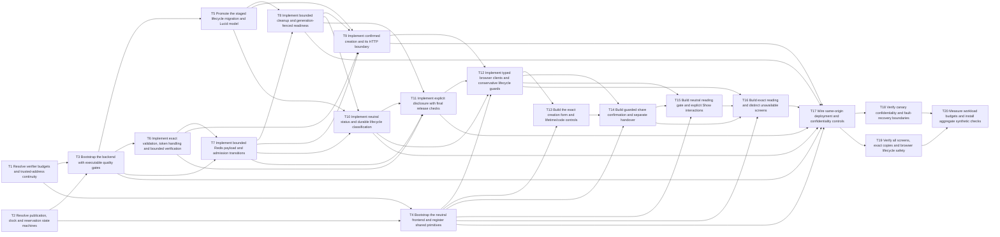

# Epic — short-live-path

> Spec: [spec.md](../spec.md) · Design: [sad.md](../sad.md) · Data model: [data-model.md](../data-model.md) · API: [openapi.yaml](../contracts/openapi.yaml) · ADRs: [adr/](../adr/)

## Goal

Deliver anonymous temporary text-only sharing, optional independent Reading codes and repeated explicit reading with exact copying. Service deadlines, bounded ephemeral deletion and durable metadata recognition remain separate obligations. Source: [spec.md](../spec.md) §2, goals, abridged.

Size M, route standard. This is a provisional planning package, NOT executable implementation readiness. No application, manifest, design-system inventory or architecture-map exists at breakdown time. Planned paths are not existing APIs or imports.

## Scope

- In: two decision sessions, backend/frontend foundations and reviewed design canon, staged lifecycle migration promotion, exact validation and bounded ephemeral admission, cleanup/readiness, three HTTP operations, SCR-01…05 and runtime/retention/browser/performance verification.
- Out: accounts, per-person access, history, lost-link/code recovery, uploads, one-time reads, early deletion, external credential operations and recipient-copy revocation. Source: [spec.md](../spec.md) §3, non-goals, abridged.
- Draft gate: DM-OQ-01…05 remain OPEN in [data-model.md](../data-model.md) §Open technical decisions. T1 resolves verifier/proxy policy; T2 resolves publication/time/admission protocols. Both require recorded review, not agent-selected guesses. All T3…T20 are blocked on these gates (transitively). Re-run tasks after upstream resolution before dispatching implementation: their snapshots/contracts/hints may change. tasks.json deliberately has no custom readiness field; the engine must follow the task-body gate and prerequisites, not infer approval from file existence.
- An 8h decision session is a timebox, not a promise of approval. If unresolved, retain blocked status and split/replan rather than manufacture an accepted choice. Runtime task estimates are provisional until those protocols and actual scaffolds exist; target <=1 working day and roughly <=500 LOC per focused change.
- Browser/version/hardware/network profile remains spec §8 / SAD §11 input required BEFORE plan-tests. T4 establishes docs/design-system.md before feature UI, matching the component gap in [screens.md](../screens.md) §Source, inherited blockers/component gap, abridged. This package does not waive either prerequisite.

## Task map

DAG waves express dependency depth, not elapsed delivery days. T1/T2 share upstream artifacts and must serialize writes despite being separate roots. After the decision gate, T3 backend and T4 frontend are genuinely parallel branches; T5 metadata and T6 validation can also run independently. T9/T10 share routes; UI tasks share canon/components; overlap lanes serialize those edits. T18 and T19 operate on separate backend/security versus browser evidence. See each task's lane before parallel execution.

## Tasks

See [tracker.md](tracker.md) for status. Machine contract: [tasks.json](../tasks.json).

| # | Task | Layer | Blocked by | DoD (short) |
|---|---|---|---|---|
| T1 | [Resolve verifier budgets and trusted-address continuity](resolve-verifier-address-policy.md) | docs | — | Decision review verifies DM-OQ-01/05 have concrete reviewed values, benchmark evidence and spoofing/restart/rotation test vectors; no unresolved value is marked approved. |
| T2 | [Resolve publication, clock and reservation state machines](resolve-time-admission-protocol.md) | docs | — | State-machine review walks success, uncertainty, stale-owner, clock-rollback and recovery vectors against AC-04/07/10/11; all DM-OQ-02/03/04 choices are reviewed before this gate closes. |
| T3 | [Bootstrap the backend with executable quality gates](bootstrap-backend.md) | wiring | T1, T2 | Docker backend smoke test, pnpm test/lint/typecheck/build scripts and a deliberately invalid layer-import fixture prove active gates; no sensitive endpoint serves before readiness. |
| T4 | [Bootstrap the neutral frontend and register shared primitives](bootstrap-frontend-canon.md) | ui | T1, T2 | Neutral-shell/component tests prove no disclosure request on navigation, keyboard focus/labels/busy states at 360px, active layer lint and green Docker frontend test/lint/typecheck/build. |
| T5 | [Promote the staged lifecycle migration and Lucid model](promote-lifecycle-migration.md) | migration | T3 | Disposable PostgreSQL integration tests apply/revert/reapply the promoted Lucid migration and test all 1–1440-minute durations, invalid digests/times, uniqueness and no sensitive columns. |
| T6 | [Implement exact validation, token handling and bounded verification](validate-and-hash.md) | domain | T3 | AC-citing unit tests cover multibyte/exact multiline boundaries, surrogate rejection, canonical token padding bits, exact code comparison, malformed verifiers and reviewed work-queue exhaustion. |
| T7 | [Implement bounded Redis payload and admission transitions](redis-admission-store.md) | infra | T3, T6 | Real-Redis integration tests race both quotas and all caps, exercise exact rolling boundaries, short/failed/successful attempts, lease fencing, OOM/timeout partial outcomes and five-minute state retention. |
| T8 | [Implement bounded cleanup and generation-fenced readiness](cleanup-recovery.md) | app | T5, T7 | Real-Redis/PostgreSQL fault tests measure <=60s active deletion and prove cleanup-before-serving after suspension/reconnect, stale-owner fencing, PostgreSQL-outage cleanup and no early-payload recovery. |
| T9 | [Implement confirmed creation and its HTTP boundary](create-secret.md) | ports | T5, T6, T7, T8 | createSecret contract/integration tests assert 201/422/429/503, exact service-established successful timestamps, no link on uncertain commits, 25-success rolling quota and orphan nonextension. |
| T10 | [Implement neutral status and durable lifecycle classification](neutral-status.md) | ports | T5, T7, T8 | getSecretStatus contract tests verify four 200 variants, malformed token stops before lookup, no fragments or mutation, known expiration after Redis restart and 503 for corruption/dependency uncertainty. |
| T11 | [Implement explicit disclosure with final release checks](explicit-disclosure.md) | ports | T6, T7, T8, T10 | discloseSecret tests cover all 200/403/409/410/422/429/503 outcomes, parallel five-failure reservations, repeat readers and delayed correct verification/readiness changes at final release. |
| T12 | [Implement typed browser clients and conservative lifecycle guards](browser-data-time.md) | app | T4, T9, T10, T11 | Deterministic client/clock tests cover wall-clock rollback, transit, suspend discontinuity, invalid/superseded late responses and stale clipboard callbacks with zero late display eligibility. |
| T13 | [Build the exact creation form and lifetime/code controls](create-form.md) | ui | T4, T12 | SCR-01 component tests cover every manifest state, 1/60/61/1440/fractional minute interactions, multibyte size boundary, code point/generator behavior, retained input and single-submit/no-auto-retry. |
| T14 | [Build guarded share confirmation and separate handover](share-confirmation.md) | ui | T4, T12, T13 | SCR-02 tests prove only confirmed link/code handover, separate exact copy, safe failure feedback, no credential repetition, accessible countdown and local expiry disabling all handover actions. |
| T15 | [Build neutral reading gate and explicit Show interactions](reading-gate.md) | ui | T4, T12, T14 | SCR-03 tests cover all manifest states, no POST on navigation/resume/status, explicit repeated Show, missing/wrong/short codes, shared-pair 429, safe 503/offline return and 409 reclassification. |
| T16 | [Build exact reading and distinct unavailable screens](read-unavailable.md) | ui | T4, T12, T14, T15 | SCR-04/05 tests assert byte-exact multiline field/clipboard text, denied-copy manual fallback, no script/link execution, all safe terminal states and no late/stale/partial content restoration. |
| T17 | [Wire same-origin deployment and confidentiality controls](secure-compose-wiring.md) | wiring | T3, T4, T8, T9, T10, T11, T16 | Disposable Compose smoke/integration checks prove direct same-origin routing, private stores, no-store/no-referrer on all outcomes, startup fail-closed and inspected Redis persistence/noeviction configuration. |
| T18 | [Verify canary confidentiality and fault-recovery boundaries](confidentiality-recovery-audit.md) | tests | T17 | Canary audit has zero payload/code/full-link log/backup hits; fault suites prove no late releases, <=60s deletion while cleanup executes and cleanup-before-serving, or explicitly block launch with evidence. |
| T19 | [Verify all screens, exact copies and browser lifecycle safety](browser-lifecycle-e2e.md) | tests | T17 | AC-citing E2E/accessibility tests pass on the approved narrow/desktop browser matrix with zero app console errors, no automatic disclosure and no stale/late plaintext after lifecycle transitions. |
| T20 | [Measure workload budgets and install aggregate synthetic checks](performance-observability.md) | tests | T18, T19 | Reproducible load report records achieved eligible throughput/p95, error/limit mix and deletion latency; synthetic/alert smoke tests pass without sensitive labels, and monthly availability remains explicitly unmeasured until a full calendar window. |

Total: 20 tasks, 150h = 18.75 person-days at eight hours/day. No staffed owners or overnight delivery are promised; <TBD lead> denotes a responsibility to assign.

## Risks / Hard rules

- HTTPS and live server-readable processing are accepted; no browser/operator-blind encryption requirement. No Secret/code/verifier persistence, backups or payload-bearing telemetry; PostgreSQL only retains UUID/digest/creation/expiration metadata. Source: [adr/](../adr/) §Decision outcome, ADR-0003/0005, abridged.
- Final service release must be strictly before expiration, independently of cleanup. Active records delete within 60s while Redis executes; suspension has no physical RAM-erasure deadline and recovery cleans before serving. Source: [spec.md](../spec.md) §5, AC-10/11, abridged; [adr/](../adr/) §Decision outcome, ADR-0004, abridged.
- Never silently reset active address/pair quotas on restart/rotation, free a possibly committed slot, extend orphan deadlines, evict existing payloads or treat script isolation as rollback. Source: [data-model.md](../data-model.md) §Temporary admission state, reservations/continuity, abridged.
- Schema promotion uses installed Lucid BaseSchema; rollback destroys durable recognition and requires authorization/metadata-only backup. No production command is part of this breakdown. Source: [data-model.md](../data-model.md) §Migrations and rollback, staged pair, abridged.
- Every task names tests/review vectors, but real security review, benchmark, monthly availability and host retention evidence remain unperformed. Tests use synthetic data and AC-citing case names. Source: [sad.md](../sad.md) §10/11, quality/readiness, abridged.

Structural verification evidence: [tasks-validation.md](../_audit/tasks-validation.md). Passing structural validation is not approval of unresolved decisions or runtime behavior.
