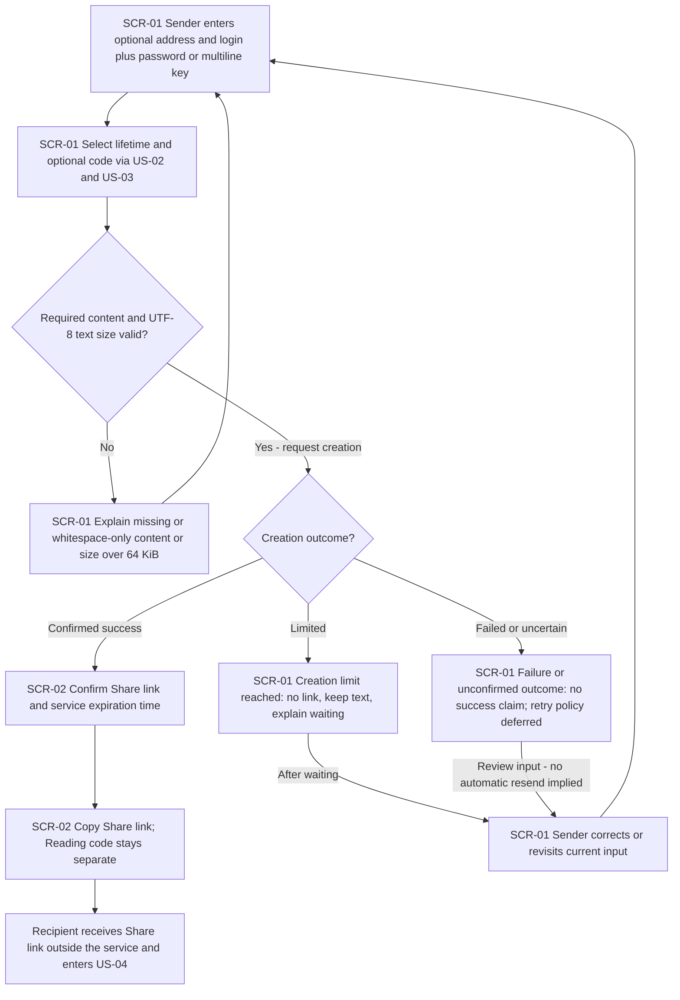
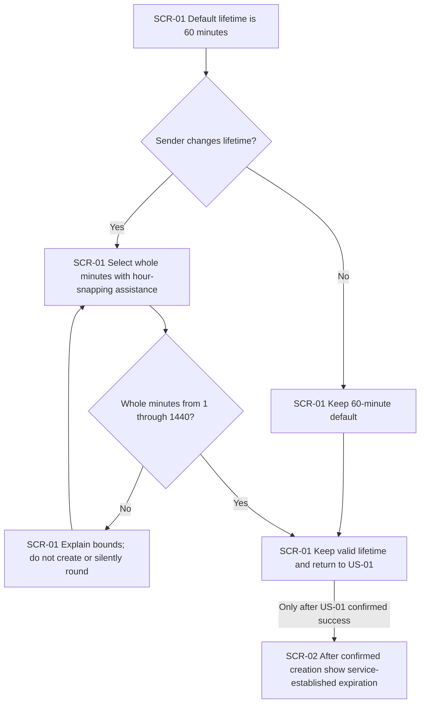
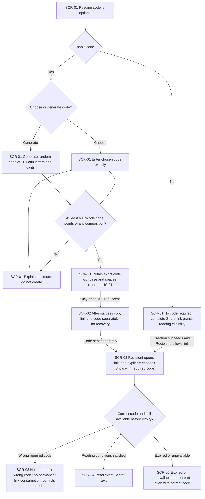
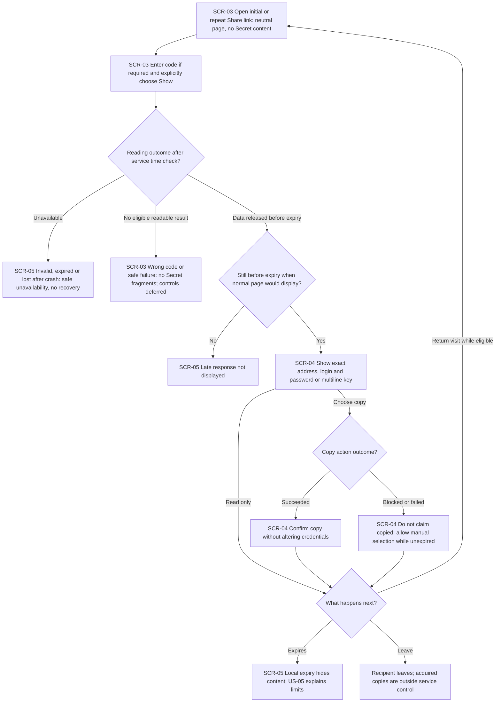
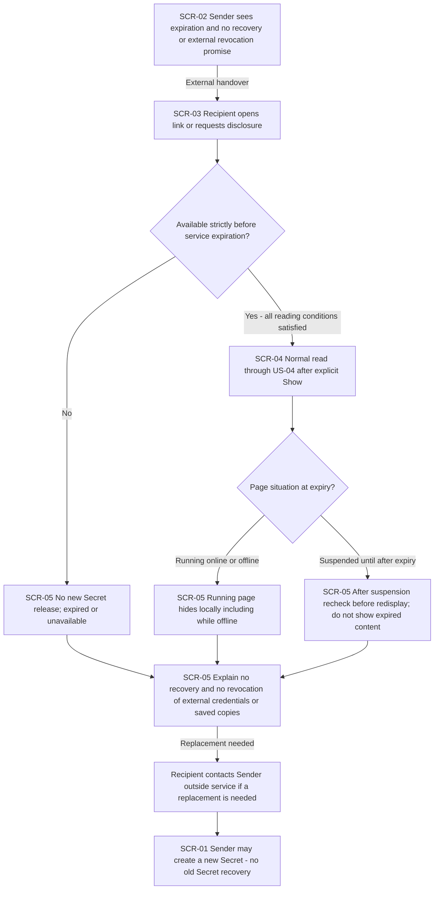

# UX flows — short-live-path

> Sources: [spec.md](./spec.md), [CONTEXT.md](./CONTEXT.md), and [clarify-log.json](./clarify-log.json). One flow per UI-touching user story. This is navigation and interaction behavior, not screen layout, styling, component selection, or an implementation architecture.

## Platform decisions

- **Posture:** responsive-both, explicitly confirmed by Product Owner. Creation and reading support both mobile and desktop; minimum width 360 pixels and primary actions keyboard-operable, per NFR-06.
- **Depth:** medium; each flow must be confirmed in prose after syntax validation.
- **Design tool context:** docs/design-system.md is absent. Work uses code-mode assumptions; no visual system is invented here. Run design-system before detailed visual screen work.
- **Navigation:** one creation flow contains content entry, lifetime selection and optional Reading code selection. These are parts of SCR-01, not separate wizard screens. SCR-02 appears only after confirmed creation. Product Owner requests a lifetime slider with hour snapping while retaining all whole-minute values from 1 through 1440; exact control interaction and keyboard/mobile behavior belong to screens. This is an explicit user constraint, not a component-library or styling decision.
- **Reading:** opening a Share link reaches SCR-03 without Secret content. A separate explicit Show action is always required, including for links without a Reading code. This is preview protection, not identity verification.
- **No account or history:** no sign-in, dashboard, file transfer, Secret editing, recovery or early removal is introduced. A return visit is a fresh reading flow, not a history entry.
- **Confidentiality:** copy the Share link and Reading code separately; never put the Reading code into the Share link or a combined automatic handover message. Content, codes, complete links and decryption keys must not leak through telemetry.
- **Expiry:** the service owns the time boundary. Do not release data at or after expiry; do not display late responses in the normal application. Hide locally while offline and recheck before redisplay after suspension. Already acquired copies cannot be revoked.
- **Failure scope:** earlier loss after a crash/restart is allowed; unavailable Secret content cannot be recovered. Error details, temporary wrong-code controls and uncertain-creation retries remain explicit spec section 8 decisions, not invented UX guarantees.
- **Surface evidence:** a human-facing browser experience for Sender and Recipient is required. Formal target_surfaces and technology choices belong to design.

## Screen inventory

IDs name distinct user-facing experiences, not necessarily distinct routes. A return to a screen with a validation or safe-error message does not create a new SCR ID.

| ID | Screen | Purpose | Entry | Exit |
|---|---|---|---|---|
| SCR-01 | Create Secret | Enter optional address/login, required password or key, lifetime, optional Reading code; correct validation errors | Initial visit; choose to create a new Secret | Confirmed creation to SCR-02; safe validation, limit or creation-failure outcome remains here |
| SCR-02 | Share confirmation | Provide confirmed Share link and expiration; communicate optional Reading code separately and explain confidentiality/recovery limits | Confirmed successful creation from SCR-01 | External handover to Recipient; optional new creation at SCR-01; no history or automatic recovery |
| SCR-03 | Neutral reading gate | Offer explicit Show and optional Reading code entry without disclosing the Secret or consuming the link | Initial or repeated Share link visit; return after leaving SCR-04 while still eligible | Successful explicit reveal to SCR-04; unavailable or expired to SCR-05; safe no-content errors remain here |
| SCR-04 | Read Secret | Read and copy exact Secret text during the permitted window | Explicit Show from SCR-03 after all reading conditions and expiry checks pass | Expiry or later unavailability to SCR-05; return visit begins at SCR-03; leave the application |
| SCR-05 | Unavailable Secret | Explain safe unavailability, no recovery, and limits of expiry without Secret fragments | Invalid, expired, lost-after-crash Secret; expiry while reading; late response not displayed | Leave; contact Sender externally for a replacement; Sender may start a new creation at SCR-01 |

## Flows

### Flow: US-01 — Create and share credentials

Rendered diagram: [Flow US-01 PNG](./_diagrams/ux-flow-1.png).

The Sender enters text without registering. Lifetime and code choices follow US-02 and US-03. Missing or whitespace-only password/key, or a total above 64 KiB of UTF-8 address/login/password-or-key text, keeps the Sender at SCR-01 with an explanation. Nonempty credentials are never trimmed, normalized or reformatted. Creation limits issue no link, retain the current text and explain waiting. Failure or an uncertain response does not claim success; no automatic resend or deduplication promise is made before the owned retry decision. Only confirmed success reaches SCR-02 with the Share link and actual expiration. The link and optional code are handed over separately outside the service. A clipboard failure must not falsely report a successful copy. Manual selection is the approved fallback where applicable, without changing credential text or introducing server persistence.

### Flow: US-02 — Set the sharing lifetime

Rendered diagram: [Flow US-02 PNG](./_diagrams/ux-flow-2.png).

The Sender starts with sixty minutes and can keep the default or choose every whole-minute value from one through 1440. The requested slider assists selection by snapping to hours without restricting the available values to whole hours; the exact interaction is explicitly deferred to screens. Invalid, fractional or out-of-range submitted values block creation with an explanation; they are not silently rounded or clamped. A valid selection returns to the creation flow. The clock starts only when the service successfully creates the Secret, not while the Sender is filling in the form. SCR-02 and the reading experience show a visible remaining-lifetime countdown based on service-established expiration and service time; changing a Recipient device clock does not extend the window. Earlier loss after a crash remains possible.

### Flow: US-03 — Add a reading code

Rendered diagram: [Flow US-03 PNG](./_diagrams/ux-flow-3.png).

The Sender can leave code protection off, choose a code, or generate a random twenty-character Latin-letter-and-digit code. Chosen codes shorter than six Unicode code points block creation; longer codes and any character composition are allowed up to the Accepted ADR-0006 maximum of 1024 UTF-8 bytes, without blocking complexity requirements. Oversized code input is rejected without truncation, a new link or a wrong-code failure; keep current input for correction. Global work saturation or unsafe address/continuity is temporary unavailability, not incorrect code. This is a T1 policy refinement to the existing correction/no-content branches, not a new screen or navigation flow. Informational weak-code guidance does not block creation. The twenty-character generator remains available. Code comparison preserves case and spaces without trimming or normalization. The Product Owner accepted the weaker minimum after being informed that predictable short codes are susceptible to guessing and website attempt limits cannot prevent offline attacks. After successful creation the optional code is communicated separately from the Share link; no recovery is offered if either is lost. Recipient reading always passes through explicit Show. An incorrect required code reveals nothing and does not permanently consume the link; temporary attempt controls and safe error distinctions remain owned design questions. A correct code, or no code when none is required, permits reading only while the Secret is still available before expiration. Expired/unavailable data never becomes readable just because a code is correct.

### Flow: US-04 — Read and copy credentials

Rendered diagram: [Flow US-04 PNG](./_diagrams/ux-flow-4.png).

Every initial or repeat visit begins at the neutral gate without registering. After optional code entry and explicit Show, an invalid, expired or crash-lost Secret leads to SCR-05 with no fragments or recovery. Wrong-code or other safe failure does not reveal content; detailed security-sensitive error distinctions are deferred rather than invented. The service checks immediately before release and the page checks before display; a late response is not shown. Otherwise SCR-04 preserves all credential characters, spaces and key line breaks. Copy success is confirmed only when successful; on clipboard denial/failure, the confirmed flow permits manual selection without changing the text while still unexpired. Concurrent and repeated reads do not consume the link. Expiration moves to the unavailable experience; leaving or returning never revokes copies already acquired. Manual-copy fallback was explicitly approved; it is not a storage or download feature.

### Flow: US-05 — Understand expiration and limits

Rendered diagram: [Flow US-05 PNG](./_diagrams/ux-flow-5.png).

The Sender sees the confirmed expiration and recovery limits at sharing time. A Recipient cannot obtain a new service release at or after that time, even with the correct code or a request that started earlier. A normal running page hides content locally at expiry without needing network access. A suspended page checks the boundary before redisplay on return; late arrivals are never shown. SCR-05 explains unavailability without fragments, recovery or a promise to revoke an external password/key or erase already acquired Secret-content copies. A Recipient can contact the Sender externally; the Sender may create a new Secret rather than recover the old one. Storage erasure within sixty seconds while Redis can execute cleanup, and expired-record cleanup before serving after suspension/hang, are service obligations, not an observable screen transition; it remains separately testable under AC-11/NFR-03 and the storage design question. The diagram does not fabricate a UI acknowledgment proving physical deletion.

## AC coverage

| AC | Shown by | Notes |
|---|---|---|
| AC-01 | Flow US-01 U1E confirmed-success branch to U1H and U1I | No registration; confirmed Share link and service expiration only after success |
| AC-02 | Flow US-01 U1C no branch to U1D | Missing/whitespace-only credential or UTF-8 total over 64 KiB blocked; no link; no normalization of valid credential text |
| AC-03 | Flow US-04 U4H and U4I to U4J/U4K | Reading and copying preserve exact text and key line breaks; clipboard failure never claims success |
| AC-04 | Flow US-02 U2A/U2C or U2D/U2E yes to U2G/U2H | Default sixty minutes; accepted whole-minute choice; creation-time anchor; service-owned clock |
| AC-05 | Flow US-02 U2E no to U2F | Out-of-range or fractional duration blocked with explanation, not silently adjusted |
| AC-06 | Flow US-03 U3B/U3D through U3G and U3J | Optional code, minimum length, exact matching, random generation, separate handover |
| AC-07 | Flow US-03 U3L wrong-code branch to U3M; valid branch to U3N; unavailable branch to U3O | No fragments or permanent link consumption on wrong code; correct code cannot override expiry |
| AC-08 | Flow US-04 U4A/U4B/U4H/U4L return branch; Flow US-03 no-code branch | Initial and repeated explicit reading, no account or one-time consumption; concurrent reads allowed |
| AC-09 | Flow US-04 U4C unavailable to U4D; opening U4A remains neutral | Safe unavailability without content; opening alone does not consume a valid link |
| AC-10 | Flow US-04 U4F no to U4G; Flow US-05 U5C no, U5G and U5H | Service pre-release boundary, late responses, local offline hiding and resume-before-display check; no remote revocation promise |
| AC-11 | Flow US-05 U5D/U5I covers only user-facing expiry explanation; N/A for storage erasure/logs/backups: service-only obligation without a UI action | Scoped active-Secret-data erasure (sixty seconds while cleanup can execute, cleanup before serving after suspension/hang) and exclusions from logs/backups require service, recovery and security tests; no screen proves storage deletion |
| AC-11b | Flow US-04 U4C unavailable to U4D, then Flow US-05 U5I/U5J/U5K | Crash/restart may lose unexpired Secrets; no recovery; request replacement from Sender |
| AC-12 | Flow US-05 U5I | Explain no external password/key revocation or erasure of saved Recipient copies |

## Scope and unresolved design inputs

All five user stories touch the UI and have a flow; no backend-only user story is silently omitted. Storage erasure, accepted server-readable processing, log/backup exclusion, global resource controls and Reading code verification are service concerns or owned design decisions, not new screens.

The remaining open questions in spec section 8 remain owned and scheduled; operator-blind encryption was explicitly withdrawn during design, including the newly deferred exact hour-snapping interaction before screens approval. Design now resolves uncertain creation outcomes: no automatic retries, manual retry creates a new record, and any unreachable previous record keeps its original expiration. Capacity is 1000 active Secrets with Redis limited to 256 MiB and no eviction for new creations. The creation limit is 25 successes per rolling sixty seconds per address. Code failures use the approved five-per-rolling-minute link/address-pair limit without permanent link consumption; corruption handling and concrete implementation controls remain design obligations. These diagrams supply branch placeholders and safe bounds for design, not answers to those questions.

## Design-stage amendment

Product Owner confirmed server-readable processing over HTTPS and retained the optional Reading code. No recipient identification or per-person binding is introduced: the same link and optional code may be shared with multiple people. Browser encryption, fragment-carried keys and protection from live operator inspection are not required. Log/backup exclusions, exact text, explicit Show, repeated/concurrent reading, expiration and erasure remain mandatory. Diagrams are unchanged: this revises internal processing, not the confirmed navigation. Earlier offline-guessing discussion below records historical UX confirmation, not a current browser-encryption requirement.

Product Owner subsequently approved the scoped deletion guarantee: sixty seconds while Redis can execute cleanup, no physical RAM-erasure deadline during process/VM suspension or hang, and expired-record cleanup before serving resumes. No persistence/backups/recovery; no promise of forensic RAM zeroization. The UI expiration behavior is unchanged.

Product Owner also approved a visible remaining-lifetime countdown and PostgreSQL retention of minimal lifecycle metadata indefinitely for now. Known expired URLs resolve to SCR-05 with an explicit expired message, not a missing-page/404 experience. Unknown URLs are safely unavailable; a known unexpired link whose Redis content was lost shows early unavailability. PostgreSQL stores no Secret text, code/verifier or full link. This amendment changes state detail and timing presentation, not screen IDs or navigation; detailed countdown presentation belongs to screens.

## Confirmation record

- Platform: responsive-both confirmed by Product Owner.
- US-01: confirmed in prose by Product Owner.
- US-02: confirmed after one fix: requested hour-snapping slider, with the full minute-level range retained; exact interaction deferred to screens.
- US-03: confirmed after one fix: minimum six arbitrary Unicode code points, longer codes allowed, no blocking complexity requirements, twenty-character random generation retained; spec AC-06 and security guidance synchronized with explicit risk acceptance.
- US-04: confirmed in prose, including manual-copy fallback.
- US-05: confirmed in prose; deletion verification remains a service test, not a fabricated UI proof.

## Validation

Self-check: 4/4 pass on 2026-10-22.

1. All five UI-touching user stories have one confirmed flow each.
2. All five SCR IDs used by diagram nodes exist in the inventory, and every inventory screen appears in at least one flow. Edge node references were checked against declarations.
3. All thirteen acceptance criteria are mapped. AC-11 explicitly distinguishes its UI explanation from its backend-only storage/log/backup verification.
4. All five Mermaid blocks parsed and rendered successfully using mermaid-cli with the installed Chrome executable; PNG signatures and dimensions were verified for _diagrams/ux-flow-1.png through ux-flow-5.png.

All five flows were confirmed in prose, including the final US-02/US-03 edits. Spec changes are recorded in edits-log.json; the earlier clarification log marks the superseded code minimum rather than rewriting its history. No new glossary terms were introduced. The updated spec retains all five AC coverage types and zero forbidden implementation-token hits.

This validates documentation structure, Mermaid syntax and recorded approval only, not application behavior or security. No Git repository is initialized; proposed commit: ux-flows: short-live-path.
